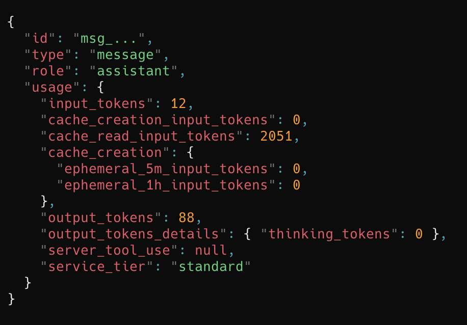
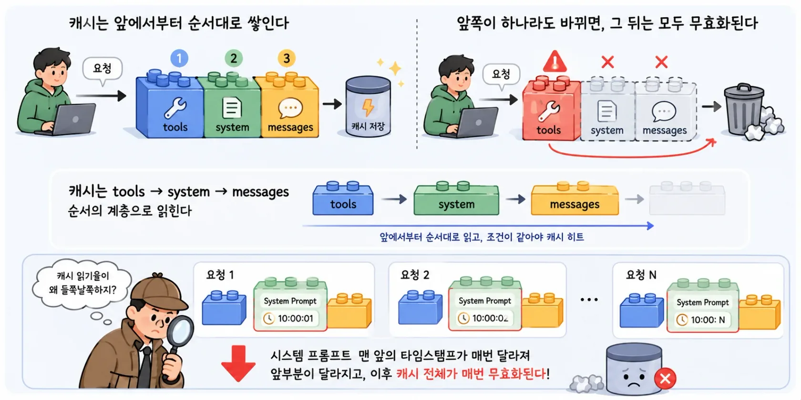
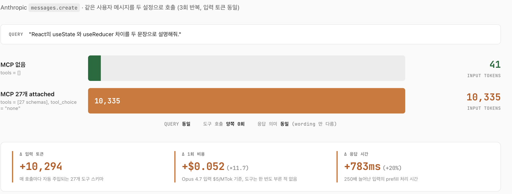
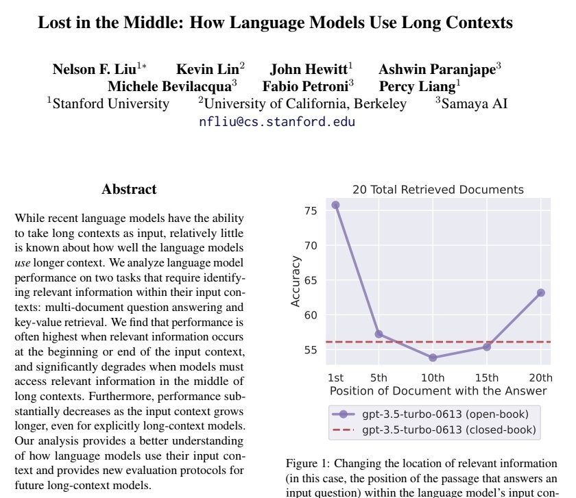
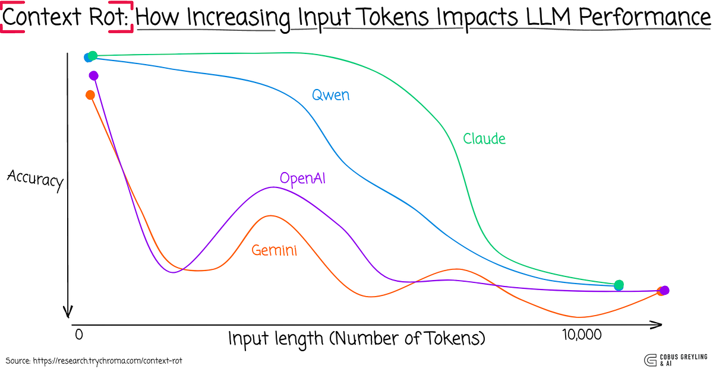
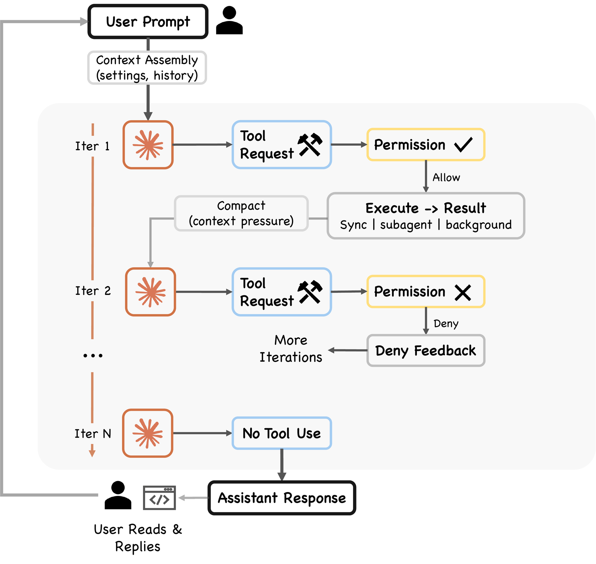
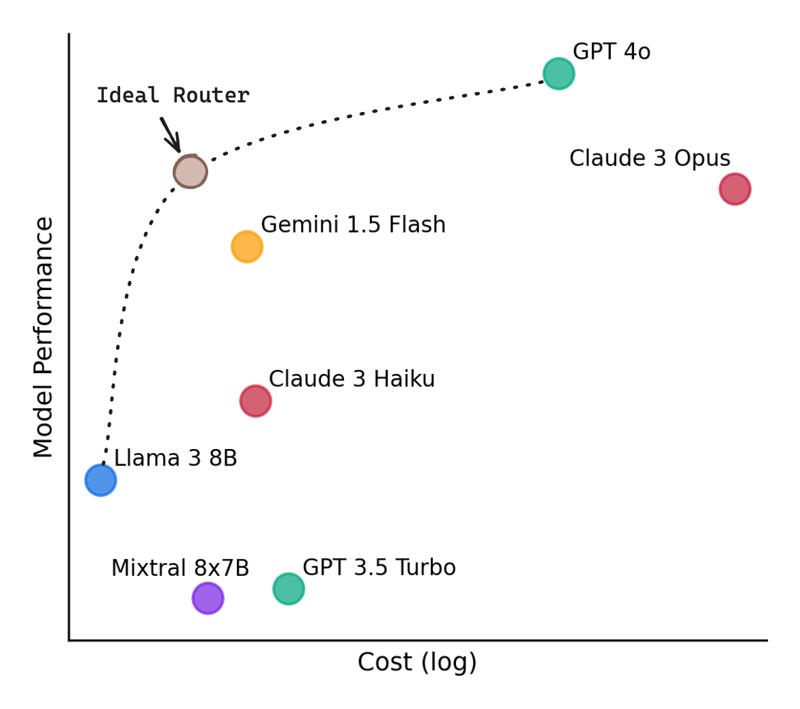
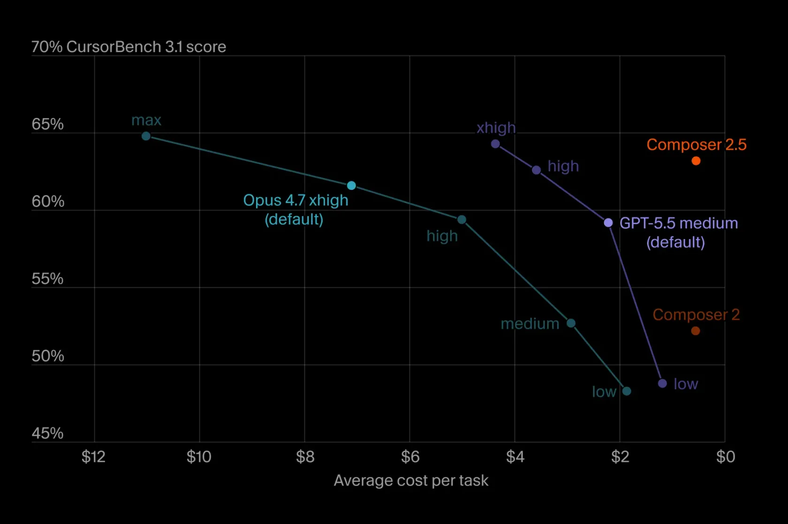
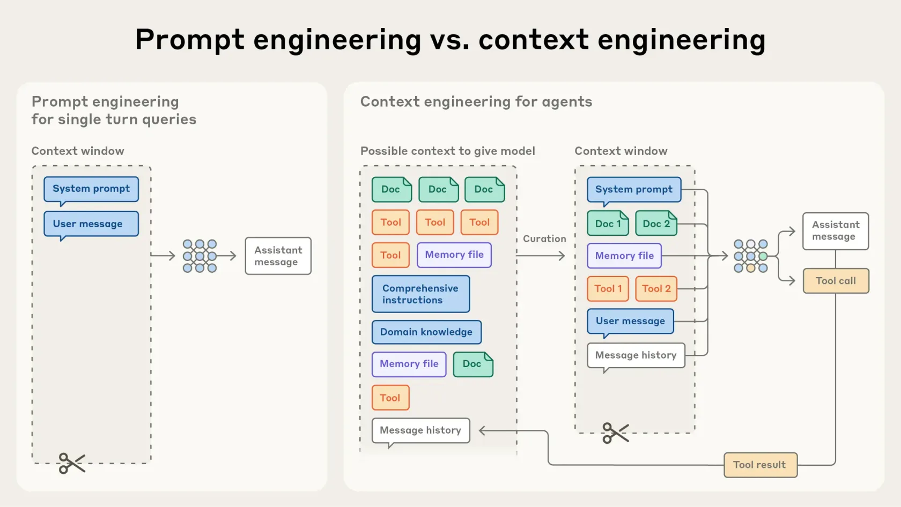

今回は、AIトークンを節約する方法について考えてみたい。

以前は性能やコストよりも、結果とプロセスに意識を向けていた。AIの成果物には穴が多く検証が欠かせなかったうえ、早く結果を出したい一心で、筆者を含む多くの人がトークン不足のたびに追加料金を払い、より上位のプランを使っていた。筆者も同じだった。（実のところ、最初の数か月はトークンにいくらかかっているかさえ気にしていなかった。）

ところが、しばらくするとトークン使用量への警戒心が次第に強くなった。個人にとって月額料金は重く、企業にとっては人件費と運用費が深刻な課題になった。[MCPとfunction calling](/260524)では、エージェントを外部システムにつなぐプロトコルを整理した。[コードインテリジェンスの4つの階層](/260526)ではコード探索ツールとGitHub Trendingを、[コンテキストファイル](/260529)ではエージェントが読むルールファイルをまとめた。このように、これまでの記事はどのようなツールがあり、それをどう使いこなすかに重点を置いてきた。その視点は今も変わらないが、時間がたてば、結局もっとも知りたくなるのはコストの話だと思う。

トークンとは何か、BPEでどう作られるか、prompt cachingが単価を下げるTransformer内部の仕組みは何かといった原理は、別の記事[トークンの仕組み](/260610)にまとめた。本稿ではその土台に立ち、料金がどう発生し、どこで無駄が生まれるのかを確認したうえで、実証済みの節約パターンを整理する。主なパターンには、同じ作業を複数の戦略で呼び出して直接測ったトークン使用量を添えた。

## トークン費用はどのように発生するのか

まず、トークン費用が生まれ、請求される仕組みを要点だけ簡潔に見ていこう。

送信したすべてのテキスト（システムプロンプト、ツール定義、会話履歴、ユーザーメッセージ）が入力トークンとなり、モデルが生成した応答が出力トークンとなる。モデルにとって、呼び出しは毎回初めて見る入力だ。昨日の会話でも1分前の呼び出しでも、新しい呼び出しでは同じ内容を入力として丸ごと送り直す。（この単純な事実がトークン費用の核心だ。モデルに記憶はなく、こちらが毎回もう一度伝えている。）

ここにもう一つ変数が加わる。同じ呼び出しを繰り返すたび静的部分を送り直すのは高くつくため、主要なLLMプロバイダーはprompt cachingを導入した。静的な入力を一度キャッシュに保存し、次の呼び出しではキャッシュから読み出したトークンを大幅に安い価格で請求する仕組みだ。（BPEでトークンがどう作られ、TransformerのKV cacheを呼び出し間でどう再利用して単価を下げるかは「トークンの仕組み」で扱った。ここでは、その原理が費用にどう換算されるかに集中する。）

### 入力トークン、出力トークン、キャッシュトークン

Anthropic SDKが応答として返す`usage`オブジェクトの四つのフィールドを見てみよう。

- `input_tokens` 送信した入力のうち、キャッシュ読み出しを除く部分
- `output_tokens` モデルが生成した応答
- `cache_creation_input_tokens` 今回の呼び出しで初めてキャッシュに保存されたトークン
- `cache_read_input_tokens` 既存のキャッシュから再び読み出されたトークン

この四つには、それぞれ異なる単価が掛かる。もっとも高いのは出力トークンで、もっとも安いのはキャッシュから読み出したトークンだ。Anthropicの公式ドキュメントでは、キャッシュ読み出しは通常の入力単価の0.1倍、つまり10%の水準である。キャッシュ書き込みは5分TTL（Time To Live、キャッシュ有効期間）で1.25倍、1時間TTLで2倍になる。初回に少し多く払い、2回目から90%引きになる構造だ。

キャッシュには、あまり知られていない制約がいくつかある。キャッシュ可能な最小トークン数はモデルごと、同じファミリーでもバージョンごとに異なる。Anthropicの公式文書によれば、Sonnet 4.6とOpus 4.8は1,024トークン、Opus 4.7は2,048トークンだ。Haiku 4.5と旧世代のOpus 4.5/4.6は4,096トークンだ。それより短いプロンプトは`cache_control`を指定しても、何の通知もなくキャッシュされない。`cache_control`のブレークポイントは1リクエストにつき最大4個で、キャッシュは`tools` → `system` → `messages`の階層順に読み込まれる。そのため、前方のツール定義が一つ変わるだけで、それ以降のキャッシュ全体が無効になる。

キャッシュで単価を90%下げられるのは、TransformerのKV cacheを呼び出し間で再利用するからだ。その内部動作は「トークンの仕組み」で詳しく説明した。コスト面で覚えておくべきことは一つだけ。キャッシュヒットはプレフィックスが完全に一致したときにしか起こらないため、**静的部分は前、毎回変わる動的部分は後ろ**に置かなければならない。プロンプトの前方にタイムスタンプが一文字入るだけでも、その後ろのキャッシュはすべて無効になる。

ここで自然な疑問が浮かぶ。「マルチターンの会話はターンごとに入力が変わる。ならば、ほぼ毎回キャッシュが壊れるのではないか」。結論から言えば、そうではない。会話の入力は毎回書き直す一塊とは異なり、**前に積み上がった内容をそのまま残し、末尾に新しい発話だけを追加する（append）構造**だからだ。システムプロンプトとツール定義、過去の質問と回答は確定するとそのまま固定され、今回の新しい質問だけが最後に付く。現在の入力を前回の入力と先頭から比べれば、最初に異なる箇所は必ず末尾の新しい質問になる。入力全体は毎回違っても、プレフィックスの大半は同じなのでキャッシュは生き残る。（毎ターンキャッシュが壊れるのは、動的な値をプロンプト前方に埋め込む誤った設計の場合だ。Claude Codeやopencodeは前方を固定して末尾にだけ追加するよう設計されており、利用者がキャッシュのために触る設定もない。入力の誤字や表記揺れがキャッシュに影響しないのも同じ理由で、その変化は常にキャッシュ対象の外側にある末尾で起こる。）

### AIの比較

2026年6月時点のAnthropic、OpenAI、Googleの公式料金を一つの表にまとめると、傾向がよく分かる。（単位は100万トークン当たりのUSD。コーディングワークフローで日常的に使うモデルを中心に選んだ。）

| プロバイダー | モデル | 入力 | キャッシュ済み入力 | 出力 |
| --- | --- | --- | --- | --- |
| Anthropic | Claude Opus 4.8 | $5.00 | $0.50 | $25.00 |
| Anthropic | Claude Sonnet 4.6 | $3.00 | $0.30 | $15.00 |
| Anthropic | Claude Haiku 4.5 | $1.00 | $0.10 | $5.00 |
| OpenAI | GPT-5.5 | $5.00 | $0.50 | $30.00 |
| OpenAI | GPT-5.5 Pro | $30.00 | $3.00 | $180.00 |
| Google | Gemini 3.1 Pro | $2.00 | $0.20 | $12.00 |
| Google | Gemini 3.5 Flash | $1.50 | $0.15 | $9.00 |

三社とも、出力単価は入力の5～6倍だ。つまり出力が長くなるほど、同じ答えでも費用は急増する。同じ価格帯内でもモデル間の単価差は3～6倍に広がる。単純な計算だけでも、**出力を短くする、同じ答えなら安いモデルを使う、静的入力はキャッシュに載せる**という三原則がトークン費用を減らす大きな柱だと分かる。（呼び出しごとに1万トークンの静的コンテキストを100回再利用するとする。GPT-5.5の通常料金では$5、キャッシュ読み出しなら$0.50。つまり一つのコンテキストを100回再利用すると、キャッシュによって実質$4.5の費用を削減できる。初回の書き込み追加料金はほとんどないため、2回目からすぐ黒字になる。）

### キャッシュ機構の違い

削減率が似ていても、内部構造はプロバイダーごとに異なる。違いが生まれる理由を知っておけば、方針を決めやすい。

| 項目 | Anthropic | OpenAI | Google Gemini |
| --- | --- | --- | --- |
| 起動方式 | 明示的な`cache_control`ブレークポイント | 自動（コード変更不要） | 自動（implicit）と明示的（explicit）の両方をサポート |
| 最小キャッシュトークン | 1,024 ~ 4,096（モデル別） | 1,024+（128単位で増加） | 2,048 ~ 4,096（モデル別） |
| キャッシュ書き込み費用 | 1.25x（5分）/ 2x（1h）の入力単価 | 無料 | 無料（代わりに時間単位の保存料） |
| キャッシュ読み出し費用 | 0.1x 入力単価 | 約0.1x 入力単価 | 0.1x 入力単価 |
| TTL | [5分または1時間（利用者が選択）](https://github.com/anthropics/claude-code/issues/46829) | 非アクティブ状態 5～10分が既定、最大1時間（拡張時24時間） | 利用者が指定（時間単位の保存料） |
| 追加費用 | なし | なし | 保存料 Flash $1/M・時間、Pro $4.50/M・時間 |

三社の設計思想がそのまま表れている。**Anthropic**はキャッシュ範囲を利用者が明示する代わりに、初回に少し上乗せ料金（1.25倍）を取り、その後は大幅に割り引く。プレフィックス位置を制御しやすく、キャッシュ読み出し率を予測できる。**OpenAI**は正反対で、すべてを自動化している。1,024トークン以上なら自動でキャッシュされ追加費用もないが、利用者が動作に介入できる余地は少ない。**Google**は両方式を提供し、明示的に制御する場合は別途保存料を課す。短く頻繁な利用なら暗黙的キャッシュ、1時間以上保管する大きなコンテキストなら明示的キャッシュと保存料のモデルが向く。

### ツール定義とトークナイザー

さらに、大きく影響する変数が二つある。

一つ目はツール定義だ。複数のMCPサーバーを接続した環境では、毎回の呼び出しにツール名とパラメータスキーマがすべて入力として含まれる（どれほど膨らむかは後で実測する）。同じツールを使っても、モデルを替えるだけで費用が変わる点にも注意したい。Anthropicの公式料金文書を見ると、ツール用システムプロンプトの長さ自体がモデルによって違う。Sonnet 4.6とHaiku 4.5は`tool_choice: auto`で約497トークン、Opus 4.7は675トークン、Opus 4.8は290トークンだ。model routingの前に「現在のモデルがツール定義をどれだけ長く展開するか」を確認すると、桁の大きな差に気づくことがある。

二つ目はトークナイザー（人が書いたテキストをモデルが処理できるトークン単位に細分化する道具）自体の効率だ。「トークンの仕組み」で触れたように、同じテキストでもトークナイザーによってトークン数は異なる。OpenAIのo200k_baseはcl100k_baseより非英語圏のテキストを大幅に節約する。AnthropicもOpus 4.7から新しいトークナイザーへ移行し、同じテキストで最大35%多くトークンを使う可能性があると明記した。単価だけでモデルを選ぶと、トークナイザー効率の差から費用が漏れる。モデルは単価×予想トークン数の積で見るべきだ。

実際に比べると、韓国語では特に差が大きい。OpenAIの二つのトークナイザーで同じ文をトークン化したところ、英語の技術文は旧版と新版でトークン数が同じだった。一方、韓国語は旧版（cl100k_base）が新版（o200k_base）より31～43%多くのトークンを使った。とりわけ注目すべきは韓国語の段落だ。167文字の一段落が旧版では169トークンとなり、**文字数よりトークン数の方が多い**結果になった。韓国語一文字が平均で一トークンを超えて占めたことになる。

旧版は韓国語をバイト単位で細かく分解する一方、新版は「개발」「입니다」のような頻出のまとまりを一つのトークンに束ねるからだ。単価が同じでも、韓国語中心の作業ならトークナイザー効率だけで請求額が1.5倍以上変わり得る。

非効率が生まれる場所を見ていこう。

## トークンを浪費する典型的なパターン

AIを使いこなしているつもりでも、トークンが非効率に流出する場面は多い。筆者自身と周囲の開発者の行動を集めると、いくつかの型に整理できる。

### 多すぎるMCPサーバーとツール定義

前節でも触れたが、改めて強調したい。MCPサーバー（Linear、GitHub、Notion、Figma、Slack、Sentry）は一度接続すると外されにくい。使わないツールスキーマが毎回入力トークンを膨らませる。Claude Codeで既定有効のMCP Tool Searchはこの問題に対処する。セッション開始時にはツール名とサーバー説明だけを載せ、全スキーマはそのツールを実際に呼び出した時点で初めて読み込む。

差がどれほど大きいか、直接測ってみた。作業中のClaude Code セッションにある27個のMCPツール（serena 10、claude.ai OAuth 4セット8、figma 2、agentmemory 7）で実験した。**同じユーザーメッセージを二つの設定で呼び出した**。一方はMCPを一つも導入していない状態、もう一方は27個すべてが接続済みだがモデルからは呼び出せない状態とし、ツール呼び出し回数は両方とも0回にそろえた。

質問もモデルも回答の意味も同じなのに、入力トークンだけが**41 → 10,335**（+10,294）へ増えた（Opus 4.7）。1回当たりの費用は、**$0.0048 → $0.0563、約12倍**である。入力が250倍に膨らみプリフィル負荷も増え、応答時間にも+**783ms**が加わった。金額以上に響いたのは、**そのターンで利用者がMCPツールを一度も呼び出さなかったとしても、毎回かかる費用**だった。前段のTool Searchが防ぐのは、この費用である。（この測定以降、筆者は普段使わないMCPサーバーを継続的に整理している。）

### コンテキストの蓄積とLost in the Middle

長い会話をそのまま引きずると、呼び出しごとの入力トークンが増えるだけでなく、モデルの正答率まで下がる。StanfordのLiu研究チームによる「Lost in the Middle」論文は、重要な情報がコンテキストの冒頭か末尾にあると最もよく見つけるという結果を示した。一方、中央に埋もれていると性能が大きく落ちるU字型曲線も定量的に示した。トークンはより多く使うのに、答えは悪くなる。Transformerのself-アテンションはトークン数の二乗に比例して計算量が増えるため、コンテキストが長いほど各トークンが受けるアテンションの絶対量が薄まる。さらに学習分布では重要情報が冒頭と末尾に集まりやすかったため、中央から先に弱くなる。

もう少し内部に入ると、モデルがトークンの「位置」を扱う方法そのものに、中央を埋もれさせる二つの性質がある。難しく聞こえるが、比喩にすれば単純だ。

第一に、モデルは**近くのトークンへより強く耳を傾ける。** 現代の公開モデルの多くが採用する位置表現RoPE（Rotary Position Embedding、回転位置埋め込み）は、二つのトークンが離れるほど結び付きを弱めるよう設計されている（距離とともに信号が薄れるdecay effect）。だから、遠いトークンほど自然に注目されにくい。

第二に、モデルは**文頭のトークンに必要以上のアテンションを流す。** モデルには、自分のアテンションを常に100%使い切るよう配分しなければならない制約（softmaxがアテンション総和を1に固定する）がある。だから、いま特に集中すべき場所がなくても、余ったアテンションをどこかへ捨てなければならない。その捨て場所は多くの場合、文頭の最初のトークンになる。このように最初のトークンが余剰アテンションを吸い込む現象をアテンションシンク（アテンションの排水口）と呼ぶ。（MITのXiao研究チームがStreamingLLM論文で初めて定量分析した現象だ。最初のトークンに重要な情報があるという説明ではなく、余ったアテンションを流す排水口として使われることで生じる副産物と見る方が妥当だ。）

この二つが重なるとアテンションは両端（近い直近トークン＋先頭トークン）へ偏り、中央の情報が最も弱く扱われる。LLaMA、Mistral、Qwenなど公開モデルの大半がRoPE系を使い、ClaudeやGPTなど非公開モデルも似た系統だと知られている。したがって、lost-in-the-middleは特定モデルのバグとは異なり、現代Transformerの構造に共通する偏りと見ることができる。

近年、この現象は**context rot**と呼ばれる。[Chroma研究チーム](https://research.trychroma.com/context-rot)がGPT-4.1、Claude 4、Gemini 2.5、Qwen3を含む18のフロンティアモデルに同じNIAH（needle in a haystack、干し草の山から針を探す）課題を与えた分析では、入力が10kから100k以上に増えると、モデルによって正答率が20～50%まで低下した。18モデルすべてが長くなるほど性能を落とし、低下が最も緩やかだったのはClaude系だった。Anthropicも、Transformerのn²アテンションに由来する「アテンション予算」が各トークンで消費される問題だと説明する。コンテキストを軽く保つことは、コスト削減であると同時に正答率を守ることでもある。

### 無分別なsubagent呼び出し

subagentが便利だからと、すべての作業を委任するのも落とし穴だ。subagentは親と別のコンテキストで始まるため、システムプロンプトとツール定義を最初から積み直す固定費がかかる。短いシェルコマンドや単純なgit確認のような軽い作業を委任すると、本文を整理する効果より開始費用の方が大きくなる。Anthropicのmulti-agent research system公開報告によると、一般的なチャットと比べて単一エージェントは約4倍、multi-agent systemは約15倍のトークンを使う。4～15倍の追加費用に見合う正答率向上があるときだけ、委任に意味がある。

同じ罠はMCPツールの接続にも当てはまる。ツールを一つ有効にするたびスキーマが毎ターンのシステムプロンプトに載り、モデルが使わないターンでも同じ費用が請求される。「使うかもしれないから全部有効にしよう」は直感的には安全に見えるが、実測はそうではない。

筆者はfacebook/react v19のreconcilerソースについて、同じ質問群を次の三つに分け、正答率と費用を測った。

- ツールなし
- 単一ツール（CodeGraph、Serena、ripgrep、bare grep）
- 四つのツールを同時に接続

結果には三つの特徴がそのまま表れた。（ここで再現率は正解を漏らさずどれだけ見つけたかを意味する。）

- **ツールなし**は平均再現率 0.31にとどまり、ツール自体の価値は明確だった。
- **Serena（LSP）のみ**は再現率 1.00、費用$0.38で、単独戦略の中でもっとも効率的だった。
- **四ツールをすべて接続**すると、再現率は逆に0.89へ下がり、費用は$0.47へ増えた。とりわけマルチホップ質問では、全接続のスコアがCodeGraph単独（0.78 / 0.88）と小数第2位まで同じだった。モデルが四つのうち一つに偏り、その弱点をそのまま受けた結果だ。

subagentとツール接続に共通する原則は一つ。追加費用が正答率向上で正当化されるときにだけ意味がある。**作業ドメインに合うツールを一つ選ぶ方が、使うかもしれないと全部を有効にするより安く、正確だ。**

実証済みの節約法を見ていこう。

## 実証済みのトークン節約法

節約パターンはそれぞれ異なるコスト軸を攻める。入力を減らすもの、同じ入力の単価を下げるもの、同じ作業を安いモデルへ任せるものがある。一つずつ見ていこう。

### Prompt caching

もっとも即効性が高い方法だ。先に見たとおり、キャッシュ読み出しは通常の入力単価の0.1倍である。初回に少し書き込み上乗せ料金（1.25倍）を払えば、2回目から同じ静的部分を10分の1の価格で再利用できる。

節約の観点から改めて強調したいのは一つだ。どの方式でも、**呼び出しごとにほぼ同じ部分**（ツール定義、コードスニペット、RAGコンテキスト）がキャッシュの対象に入る。その静的ブロックを動的内容（今回の質問、直前のツール結果）と混ぜなければ、効果はそのまま得られる。APIを直接扱うなら、静的ブロックを前にまとめ、動的部分を後ろへ移すだけで節約の大半を実現できる。Claude Codeやopencodeのような完成品なら、ツールが配置を処理してくれる。

### Batch APIで非同期作業をまとめる

呼び出しがすぐに終わる必要がなければ、Batch APIは単価そのものを下げる最も単純な手段だ。Anthropic、OpenAI、Googleはいずれも入力・出力トークンを50%割り引き、その代わり結果は最大24時間以内に受け取る。Anthropicでは実測上ほとんどのバッチが1時間以内に完了するが、SLAは24時間という意味だ。同じ呼び出しのまま単価だけ半分になるので、導入コストもほぼない。

この50%は、ほかの節約策と乗算で重なる。Anthropicの公式文書は、キャッシュとバッチの割引が互いに掛け合わされる（重ね掛け）と明記している。二つの割引は加算されず乗算されるため、静的入力の単価は標準×0.5（バッチ）×0.1（キャッシュ読み出し）＝0.05倍、つまり標準の5%まで下げられる。

どの程度違うか直接計算した。静的コンテキスト 1万トークン＋動的入力500トークン＋出力1,000トークンの作業を100件処理すると仮定し、Opus 4.8の単価で四つの戦略を比較した。

キャッシュだけなら57%、バッチだけなら50%、両方なら79%まで下がる。二つの割引が静的入力区間で掛け合わされたからだ。（出力トークンはキャッシュ対象から外れ、バッチの50%割引だけを受けるため、出力比率が高い作業ほど全体の削減幅は79%より緩やかになる。静的入力の比率が高いほど乗算効果は大きい。）夜間のコードベースの索引作成、公開前の記事評価、データ抽出、定期レポートなど、人が画面の前で待つ必要のない領域は広い。

すべての作業を非同期に回せるわけではない。利用者が回答を見て次の行動を決めるコーディングエージェントのメインセッションや対話型チャットUIなど、応答時間そのものに価値がある領域にはBatchは向かない。作業を「結果をすぐ見る必要がある」と「次の出勤までに受け取ればよい」の二つに分けるだけでも、請求額を半分にできる。

### Subagentで大量出力を伴う作業を隔離する

[Claude Code公式文書の表現をそのまま借りると、](https://www.anthropic.com/engineering/multi-agent-research-system)subagentは「独立したコンテキストウィンドウで動作し、中間のツール呼び出しと結果はsubagent内に残り、最終メッセージだけが親へ返る」。つまり大量出力を伴う作業を丸ごと委任すれば、親コンテキストに入るのは整った要約だけになる。[Anthropicのcontext engineering記事](https://www.anthropic.com/engineering/effective-context-engineering-for-ai-agents)によれば、subagentが探索に数万トークンを使っても、親へ返すのは通常1,000～2,000トークンに圧縮した要約だけだ。親コンテキストを軽く保つ効果は明確である。

> 大量出力を伴う作業とは、一行の答えを得るまでに大量のトークンを吐き出す作業を指す。テスト実行、文書検索、ログ分析などがこれに当たる。

subagentを使ったからといって総費用が常に減るわけではない。Anthropic自身の報告では、エージェントは通常のチャットの約4倍、multi-agent systemは約15倍のトークンを使う。subagentは全体のトークン支出を減らす代わりに、高価な長期コンテキストから大量の出力を切り離し、正答率と親側の費用を守る仕組みだ。だからこそ「本文整理で浮く費用が開始費用を上回る場合だけ」委任するという原則が必要だ。短い作業は親が直接処理した方が安い。

適用ドメインについても補足したい。Anthropicのmulti-agent research system報告は、内部評価でOpus 4単独エージェントに対し、Opus 4（リーダー）＋Sonnet 4（subagents）の構成が90.2%性能を向上させたとしている。けれど、この向上はすべてのドメインで同じではない。同じ記事は「エージェント同士が同じコンテキストを共有する必要がある、またはエージェント間の依存が多いドメインはmulti-agentに向かない」と明記し、コーディングをその例だと述べた。リサーチは独立した方向へ並列探索できるが、コードは一つの関数変更が別の関数へ影響する依存グラフ上で動くからだ。（コーディングにmulti-agent構成を使っているなら、そのワークフローが本当に並列探索に近いか考え直す価値がある。単一エージェント＋隔離した探索subagent一つ程度が、コーディング分野ではより安全な既定値かもしれない。）

### compactとprogressive disclosure

Claude Codeの`/compact`は、これまでの会話全体を要約へ圧縮し、新しいコンテキストで再開するコマンドだ。Anthropicの公式説明によれば、圧縮は単純な切り捨てではなく意味単位の要約で、進行中の作業コンテキストと最近の変更は残し、繰り返しのツール出力など再参照の必要が少ない部分は捨てる。`/clear`がすべてを消すのに対し、`/compact`は要約を残す点が違う。コンテキストウィンドウが95%近く埋まるとauto-compactが自動的に同じ処理を行う。長くなったセッションを一定地点で整理すれば、入力トークンの累積を断ち切れる。

内部をもう少し見ると、`/compact`は利用者が明示的に呼ぶ最終段階にすぎず、その前には自動で動く四段階のコンテキスト圧縮パイプラインがある。[Claude Codeの内部動作を分析した外部研究（「Dive into Claude Code」）](https://github.com/VILA-Lab/Dive-into-Claude-Code)によれば、すべての呼び出し直前に`query.ts`が次の五段階を順に確認する。

- **Budget Reduction**は個々のツール出力がサイズ上限を超えた部分を切り落とす。
- **Snip**は時間軸上で古い履歴を切る。
- **Microcompact**はキャッシュ認識を保ったまま微細な圧縮を行う。
- **Context Collapse**は非常に長い履歴を読み込み時に再投影し、次元を縮める。
- **Auto-Compact**は意味単位の圧縮を95%時点の最終手段として発動する。

上ほど軽く安く、下ほど重いが効果は大きい。一つの圧縮戦略ではすべてのコンテキスト圧力を解消できないという認識が、この五段構造の根拠だ。利用者が`/compact`を明示的に呼ぶ行為は、自動パイプラインの最後の段を前倒しで発動させる行為と見なせる。

同じ考え方はClaude CodeのSkillsにも入っている。`/compact`がすでに蓄積したコンテキストを事後に減らす装置なら、`/skills`の三段階読み込みは最初から蓄積を防ぐ装置だ。

Anthropic文書によると、スキルは三段階で読み込まれる。名前と一行の説明（約100トークン）だけがセッション開始時にコンテキストへ入る。本文（`SKILL.md`、5千トークン未満）はスキルが起動して初めて読み込まれる。バンドルされたスクリプトやリソースはbashで実行された際に出力だけが戻り、コード自体はコンテキストに入らない。そのため数十個のスキルを導入しても、開始時のコンテキストはほとんど増えない。

### model routing：同じ答えなら安いモデルへ

Opus 4.8とHaiku 4.5の入力単価には5倍の差がある。単純な検索、探索、短い要約まで最大モデルで処理するのは大きな損失だ。難易度に応じてHaiku → Sonnet → Opusの順に振り分け、本当に重い推論だけOpusを使うパターンが標準になりつつある。[LMSYSのRouteLLM研究](https://lmsys.org/blog/2024-07-01-routellm/)はGPT-4の品質を95%維持しながら、強いモデルの呼び出しを14%に抑えるルーターを示した（コーディング特化ではなく一般推論ベンチマークである点には留意が必要だ）。

ツールの勢力図も急速に固まっている。商用ゲートウェイにはOpenRouter、Martian、NotDiamondがある。オープンソースのセルフホスト陣営にはLMSYSのRouteLLMとLiteLLM、Bifrostなどのコスト可視化レイヤーが定着した。AnthropicのエコシステムではAgent SDKのモデル選択引数、Claude Code subagentの`model`フィールド（Exploreは既定でHaiku）、`/model` スラッシュコマンドがいずれもmodel routingのための装置だ。APIを直接呼ぶ場合、入力難易度を見てモデルが自動選択されることはない。Anthropic、OpenAI、GoogleのAPIはいずれも利用者が指定したモデル名のまま動くのが基本だ。自動ルーティングは製品（CursorのAuto、ChatGPTの自動モード、OpenRouterの`openrouter/auto`）だけで有効にできるオプションだ。model routingで費用を下げるなら、ゲートウェイか分類器を自分で構築する必要がある。

だが、外部の自動ルーターを闇雲につなぐと別の問題が生じる。OpenRouterのAuto Routerのように呼び出しごとにモデルを変えるルーターは、prompt cachingと正面から衝突する。Anthropicの一時キャッシュは同じモデル＋同じプレフィックスでしかヒットしないため、呼び出しごとにモデルキーが変わるとキャッシュキーが毎回ずれる。キャッシュ読み出しで単価を90%下げていた効果を失い、model routingで半分近く節約したのに、キャッシュミスで再び費用が漏れることも多い。OpenRouterが`session_id`ベースのスティッキーセッションのオプションを勧めるのも、このためだ。

その結果、実務が合意した形は単純だ。呼び出しごとに動的分類せず、作業種類ごとに静的分岐する。先に見たsubagentの`model`フィールドがこのパターンだ。Explore subagentには常にHaikuで動くコード探索レーンを、コードレビュー subagentには常にOpusで動くレビューレーンを持たせる。各レーンでは同じモデル、システムプロンプト、ツール定義が繰り返されるため、モデルごとに独自のキャッシュが蓄積してヒットする。「model routingが標準になりつつある」とは、呼び出しごとに分類器を走らせる動的model routingではなく、「調整役＋実行役」型の作業種類別静的分岐が標準になったという意味と見なせる。model routingとcachingが同じ設計で矛盾なく共存できる理由もここにある。

### Cursor Composer 2.5

少し性質の違う節約法だが、Cursorのようなエージェントも利用できる。[Cursorが2026年5月18日に公開した独自モデルComposer 2.5](https://cursor.com/blog/composer-2-5)は、Moonshot AIのオープンソースのチェックポイント Kimi K2.5を基に、コーディング向けにファインチューニングしたモデルだ。Cursorチームは独自ベンチマークで、Claude Opus 4.7に並ぶコーディング性能を約10分の1の価格で実現したと述べる。公開価格は入力$0.50、出力$2.50で、Opus 4.8の入力$5.00、出力$25.00と比べると、桁が一つ違う。

特化モデルのベンチマークはCursor自身の測定なので、絶対値をそのまま受け取るより、「コーディング専用に学習した小型モデルが、汎用フロンティアモデルと同じ作業で遜色ない性能を出しながら費用を一桁下げる」という流れとして読むのが安全だ。これは2026年にもっとも明確になった節約潮流の一つである。

この流れでは単価が低いだけでなく、**IDEと一体で設計すると入力トークン自体も減る。** ComposerやCascadeのようなモデルは、IDEが送るコードベースのコンテキスト（現在のファイル、隣接ファイル、索引済みのシンボル）を効率よく使うよう学習されている。だから同じ作業でも、汎用モデルが「関連ファイルをもっと見せてほしい」とgrepやreadを繰り返して膨らませる入力トークンを抑えられる。単価が一桁下がったうえトークン数も少し減る効果があるため、実際の削減幅は単価差以上になる。

### コンテキストをコンテキストの外へ

2026年に入って、コンテキストには「必要なものだけを、必要なときに」載せる流れが続いている。Anthropicはこれを**just in time（JIT）コンテキスト**と呼ぶ。すべての資料を事前にコンテキストへ入れるのではなく、ファイルパスやクエリのような軽い参照だけを持ち、実際に必要になったときツールで取り込む。Claude Codeがコードベース全体の索引を作って丸ごと載せず、globやgrepでその都度ファイルを読むのがこのパターンだ。

AnthropicがSonnet 4.5とともに公開したmemory toolとcontext editingも、同じ思想から生まれた。memory toolのメモリは、コンテキストウィンドウ内にあってセッションが終わると消える会話履歴とも異なり、人があらかじめ書いておき開始時に自動で読み込まれる`CLAUDE.md`のような設定ファイルとも異なる。memory toolは、**モデルが直接ファイルを読み書きするツール**である。

さらに見ると、二つのツールの設計はインターフェースが単純だ。memory toolでは、Claudeが利用者のインフラに用意された専用memory用ディレクトリへファイルを作成、読み取り、更新、削除する。つまりモデルは「テキストのどこかに書き留める」方式ではなく、通常のファイルシステムのようにmemoryを扱う。保存先を利用者のインフラに置くのが要点で、Claudeはコンテキストウィンドウ外に永続memoryを持てる一方、データの保存・保管方法は利用者が管理する。セッション内の記憶がコンテキスト内で揮発するのに対し、このmemoryは外側に残って次のセッションへ続く。context editingは逆方向から同じことを行う。トークン上限に近づくと古く参照されなくなったツール結果を自動で消し、会話の流れを保ったままエージェントを長く動かせる。

Anthropicの内部評価では、両者の併用でベースライン比39%、context editing単独で29%性能が向上し、100ターンのウェブ検索評価ではトークン消費が84%減った。（ベンダー自身のベンチマークである点は考慮すべきだが、方向性は明確だ。コンテキストは埋めることより、空ける設計が重要になっている。）この流れはClaude Codeの`/compact`五段パイプラインとも共通する。違いは、`/compact`がコンテキスト内部を減らすのに対し、memory toolはコンテキスト外に別のストレージを置くことだ。両者は競合せず補完する。

## まとめ

ここまで整理すると、トークン節約は三つの軸に集約できる。**同じ作業なら送る量を減らす、同じ入力なら安く送る、同じ答えなら安いモデルに任せる**。Prompt caching、Batch API、subagent隔離、`/compact`、memory toolとcontext editing、model routing、特化モデルといったパターンは、三軸のどこを狙うかが違うだけだ。そして2026年の流れを一言で表せば、コンテキストは「埋める技術」から「空け、選び取る技術」、すなわちcontext engineeringへ重心を移している。context rotが示すとおり、軽いコンテキストは費用だけでなく正答率にも有利だからだ。

もちろん唯一の正解はない。チームごとに作業パターンは違い、同じ人でも文章を書くときとコードを書くときでは費用構造が異なる。けれど、エコシステムが急速に動くほど、「昨日正しかった節約パターンが今日も正しい」という前提は危険になっている。新しいモデル、ツール、料金表を追い続け、自分の作業上で小さなPOCを試す習慣こそ、目立たなくても長く効く節約法になると思う。読者にも、自分だけのトークン家計簿を一度開いてみてほしい。（節約策がなぜ機能するのか、その根を知りたければ、「トークンの仕組み」でBPEとKV cacheもあわせて読むとよい。）

そして一つ問いが残る。コンテキストを空け、選び取る技術まで来たなら、その次はどこへ向かうのか。公開資料をたどると重心はコンテキストのさらに外へ向かう。その外側には、エージェントというシステム全体をどう動かし（harness設計）、うまく動いたかをどう測り（eval）、誤作動したときどう閉じ込めるか（containment）へと広がる領域がある。この文章が繰り返し強調した「POCで直接測る」という姿勢をシステム単位へ拡大すると、evalになる。この先の方向は、[コンテキストの次](/260622)で詳しく扱う予定だ。

:::ref
- [docs] [Anthropic Prompt Caching](https://platform.claude.com/docs/en/build-with-claude/prompt-caching)
- [docs] [Anthropic Batch Processing](https://platform.claude.com/docs/en/build-with-claude/batch-processing)
- [docs] [Anthropic Claude API Pricing](https://platform.claude.com/docs/en/about-claude/pricing)
- [docs] [Anthropic Claude Code Subagents](https://code.claude.com/docs/en/sub-agents)
- [docs] [Anthropic Claude Code MCP Tool Search](https://docs.claude.com/en/docs/claude-code/mcp)
- [docs] [Anthropic Agent Skills](https://docs.claude.com/en/docs/agents-and-tools/agent-skills/overview)
- [docs] [OpenAI Prompt Caching](https://developers.openai.com/api/docs/guides/prompt-caching)
- [docs] [OpenAI API Pricing](https://openai.com/api/pricing/)
- [docs] [Google Gemini Context Caching](https://ai.google.dev/gemini-api/docs/caching)
- [docs] [Google Gemini API Pricing](https://ai.google.dev/pricing)
- [article] [Anthropic, Managing context on the Claude Developer Platform](https://www.anthropic.com/news/context-management)
- [paper] [LLMRouterBench (Findings of ACL 2026)](https://arxiv.org/abs/2601.07206)
- [paper] [VILA-Lab, Dive into Claude Code](https://arxiv.org/abs/2604.14228)
:::
