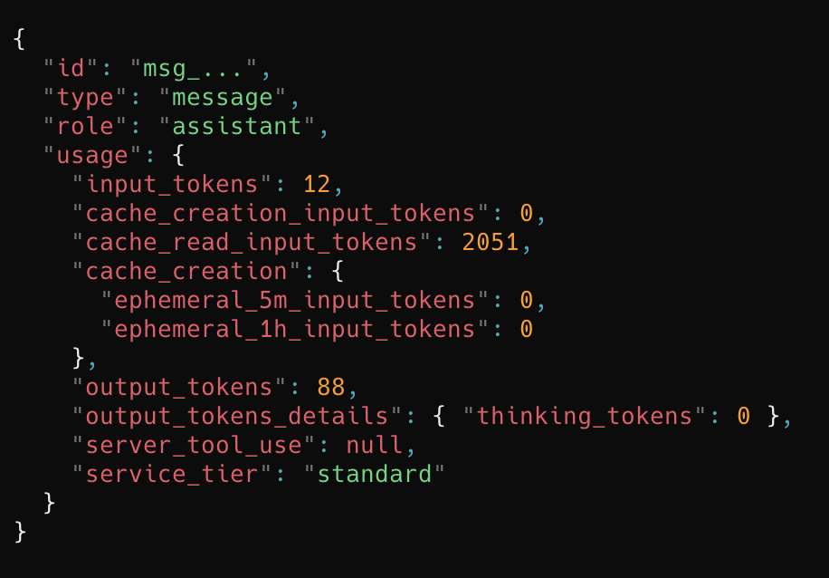
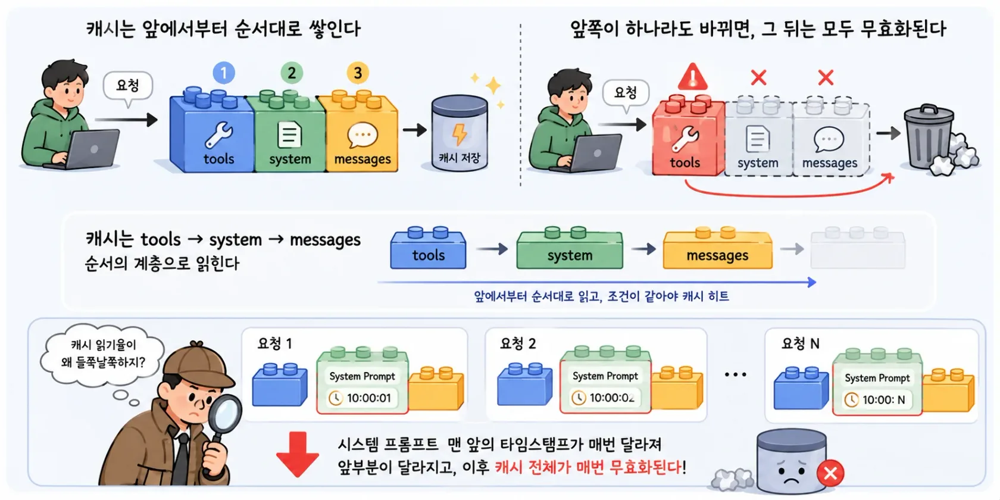
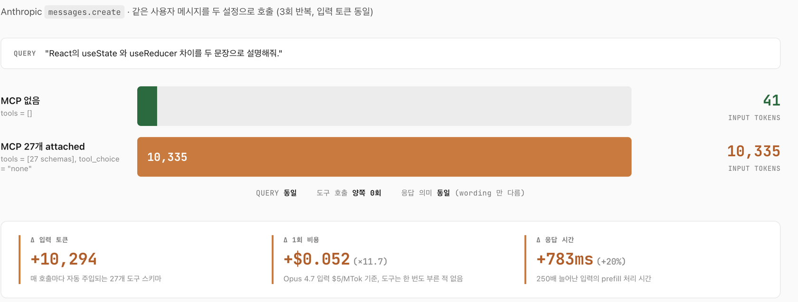
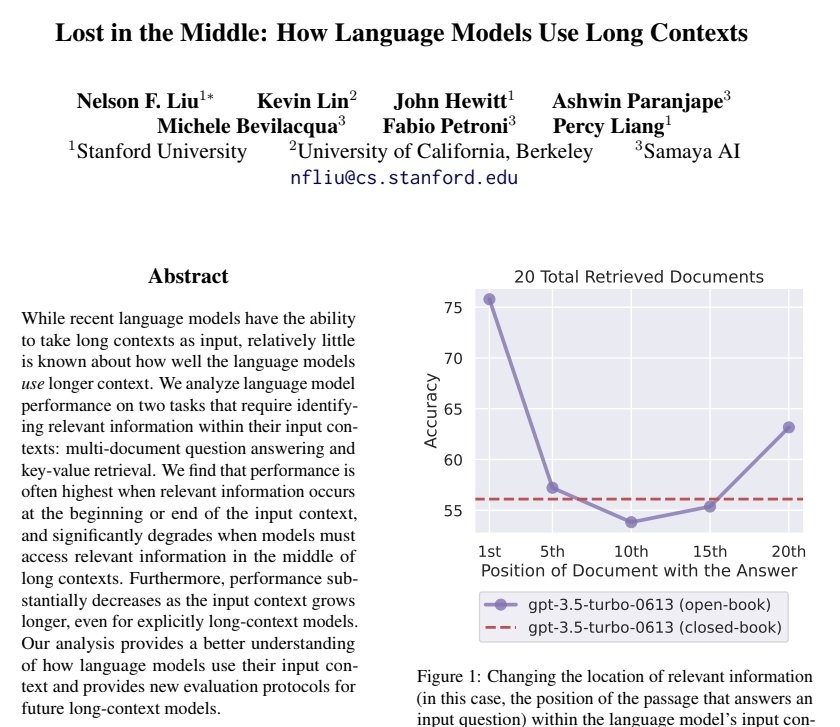
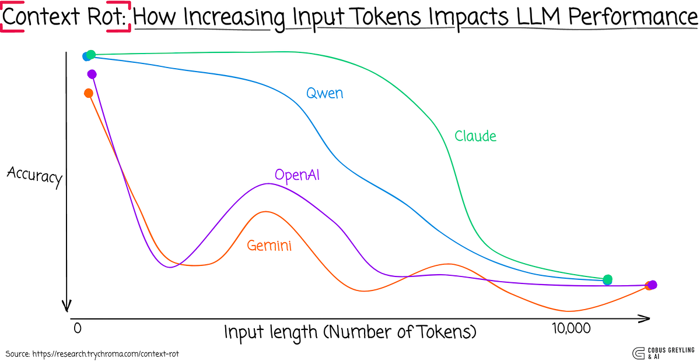
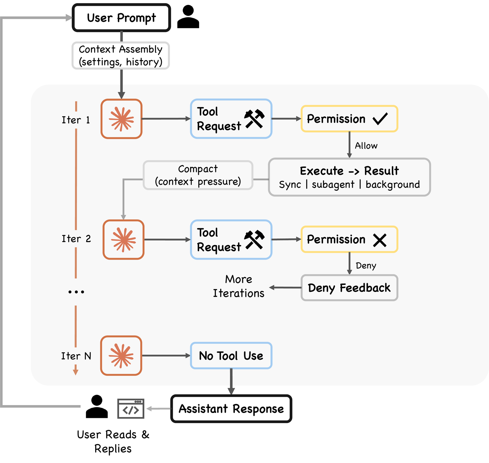
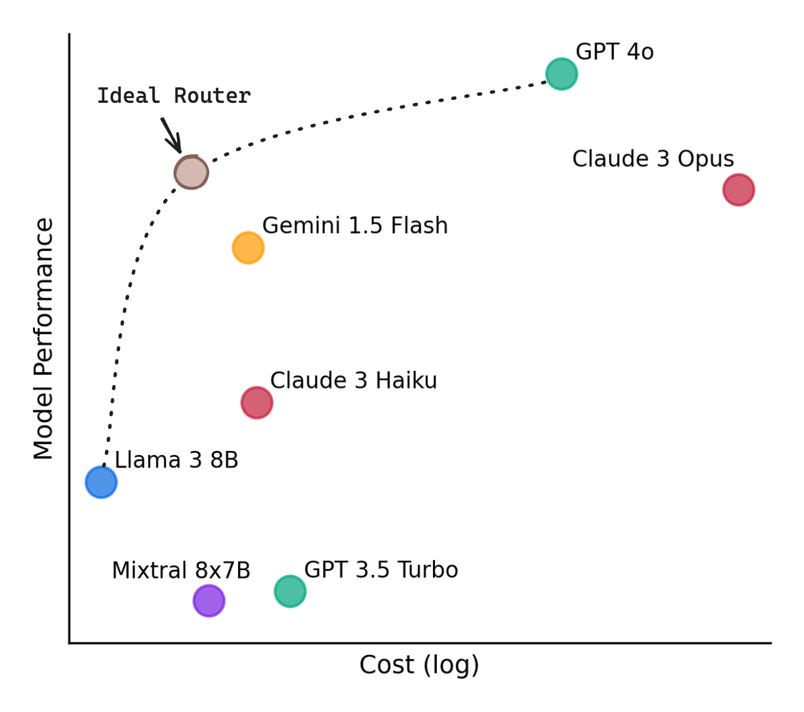
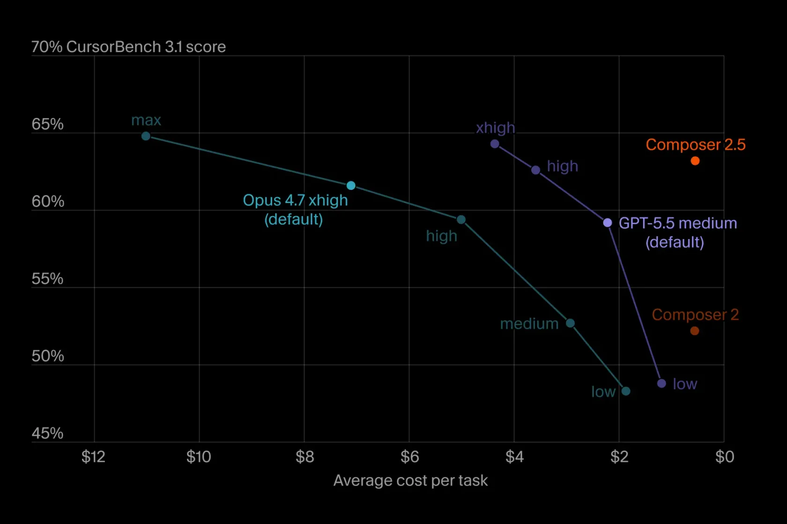
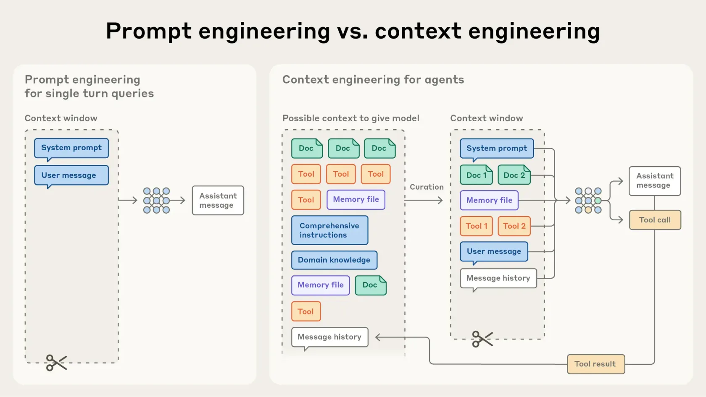

Neste artigo, quero falar sobre como economizar tokens de IA.

No começo, eu me concentrava mais nos resultados e no processo do que em desempenho e custo. Como as respostas da IA tinham muitas falhas, era preciso verificá-las; e, como queríamos resultados rápidos, muita gente, inclusive eu, comprava mais tokens ou migrava para um plano superior quando eles acabavam. Eu também fiz isso. (Nos primeiros meses, nem sequer prestei atenção em quanto gastava com tokens.)

Com o tempo, porém, fiquei cada vez mais atento ao uso de tokens. Para as pessoas, a mensalidade pesava; para as empresas, aumentavam as preocupações com custos de pessoal e operação. Em [MCP e function calling](/260524), organizei o protocolo que conecta agentes a sistemas externos. Em [Quatro camadas de inteligência de código](/260526), reuni as ferramentas de busca de código e o GitHub Trending; em [Arquivos de contexto](/260529), os arquivos de regras que os agentes leem. Assim, meus textos até aqui se concentraram mais em quais ferramentas existem e em como usá-las bem. Ainda considero isso importante, mas acredito que o custo acabará sendo a maior dúvida.

Expliquei os princípios dos tokens — o que são, como o BPE os cria e o que ocorre dentro do transformador quando prompt caching reduz o preço — em [Como os tokens funcionam](/260610). Com essa base, veremos primeiro como os custos são cobrados e onde surgem ineficiências, depois reuniremos padrões comprovados de economia. Os principais padrões vêm acompanhados do uso de tokens que medi eu mesmo executando a mesma tarefa com estratégias diferentes.

## De onde vêm os custos dos tokens?

Vamos examinar de forma breve e objetiva como esses custos surgem e como são cobrados.

Todo texto enviado — prompt de sistema, definições de ferramentas, histórico e mensagens do usuário — vira tokens de entrada; a resposta do modelo vira tokens de saída. Para o modelo, cada chamada é uma entrada inédita. Não importa se a conversa aconteceu ontem ou há um minuto: uma nova chamada envia novamente todo o conteúdo como entrada. (Esse fato simples é o núcleo do custo: o modelo não tem memória e nós contamos tudo outra vez.)

Há mais uma variável. Reenviar do zero a parte estática de chamadas repetidas é caro, então os principais provedores de LLM criaram prompt caching. A entrada estática é armazenada uma vez e, nas chamadas seguintes, os tokens lidos da cache custam muito menos. (Em Como os tokens funcionam, tratei do mecanismo: como o BPE cria tokens e como a cache reutiliza a KV cache do transformador. Aqui, o foco é como isso vira custo.)

### Tokens de entrada, tokens de saída e tokens de cache

Vejamos quatro campos do objeto `usage` devolvido pelo SDK da Anthropic.

- `input_tokens` parte da entrada enviada, excluindo leituras da cache
- `output_tokens` resposta gerada pelo modelo
- `cache_creation_input_tokens` tokens armazenados pela primeira vez nesta chamada
- `cache_read_input_tokens` tokens relidos de uma cache existente

Cada campo recebe uma tarifa diferente. Tokens de saída são os mais caros; os lidos da cache, os mais baratos. Segundo a documentação da Anthropic, a leitura custa 0,1 vez a tarifa base de entrada, ou seja, exatamente 10%. A escrita custa 1,25 vez com TTL (Time To Live, período de validade da cache) de cinco minutos e 2 vezes com TTL de uma hora. Na prática, paga-se um pouco mais na primeira chamada e economiza-se 90% a partir da segunda.

Porém, a cache tem algumas restrições pouco conhecidas. O mínimo varia por modelo e até por versão da mesma família. Segundo a documentação oficial da Anthropic, Sonnet 4.6 e Opus 4.8 exigem 1.024 tokens, e Opus 4.7 exige 2.048. Haiku 4.5 e os antigos Opus 4.5/4.6 exigem 4.096. Um prompt menor não é armazenado mesmo com `cache_control`, sem aviso. Uma solicitação aceita até quatro pontos de interrupção `cache_control`, e a cache é lida na ordem hierárquica `tools` → `system` → `messages`. Assim, mudar uma definição de ferramenta no início invalida toda a cache posterior.

O desconto de 90% vem da reutilização da KV cache do transformador entre chamadas, mecanismo detalhado em Como os tokens funcionam. Para custos, lembre apenas isto: só há cache hit quando o prefixo é idêntico. Portanto, coloque **o conteúdo estático primeiro e o conteúdo dinâmico, que muda a cada chamada, por último**. Até um caractere de timestamp no início invalida toda a cache seguinte.

Surge uma pergunta: “Mas a entrada muda a cada turno; a cache não deveria quebrar quase sempre?” Não. Em vez de ser um bloco novo escrito a cada turno, a entrada da conversa preserva o conteúdo acumulado na frente e **acrescenta apenas a nova fala no fim (append)**. Prompt de sistema, ferramentas, perguntas e respostas anteriores permanecem intactos; só a nova pergunta é anexada. Comparando as entradas desde o início, a primeira diferença estará no final. A entrada completa muda, mas o prefixo sobrevive. (A cache só quebra em todos os turnos num projeto ruim que insere valores dinâmicos na frente. Claude Code e opencode mantêm o início fixo e anexam ao fim; o usuário não precisa configurar nada. Erros de digitação também não afetam a cache, pois ficam no fim, fora do prefixo já armazenado.)

### Comparação entre provedores de IA

Ao reunir as tabelas oficiais de Anthropic, OpenAI e Google de junho de 2026, o padrão fica claro. (Valores em USD por milhão de tokens, com foco em modelos comuns na programação.)

| Provedor | Modelo | entrada | entrada em cache | saída |
| --- | --- | --- | --- | --- |
| Anthropic | Claude Opus 4.8 | $5.00 | $0.50 | $25.00 |
| Anthropic | Claude Sonnet 4.6 | $3.00 | $0.30 | $15.00 |
| Anthropic | Claude Haiku 4.5 | $1.00 | $0.10 | $5.00 |
| OpenAI | GPT-5.5 | $5.00 | $0.50 | $30.00 |
| OpenAI | GPT-5.5 Pro | $30.00 | $3.00 | $180.00 |
| Google | Gemini 3.1 Pro | $2.00 | $0.20 | $12.00 |
| Google | Gemini 3.5 Flash | $1.50 | $0.15 | $9.00 |

Nos três provedores, a saída custa cinco a seis vezes mais que a entrada. Respostas longas elevam rapidamente o custo, mesmo dizendo a mesma coisa. Na mesma faixa, os preços dos modelos variam de três a seis vezes. Uma conta simples já mostra que três princípios são a base para reduzir custos de tokens: **pedir saídas curtas, usar um modelo mais barato quando ele entregar a mesma resposta e armazenar entradas estáticas em cache**. (Fazer mais uma conta é interessante. Se um contexto estático de 10 mil tokens for reutilizado 100 vezes, custa $5 na tarifa base do GPT-5.5 e $0.50 como leitura de cache. A economia é $4.5 e, como quase não há acréscimo de escrita inicial, o retorno começa na segunda chamada.)

### Diferenças entre mecanismos de cache

Mesmo com descontos parecidos, o projeto interno varia por provedor. Entender isso facilita definir políticas.

| Item | Anthropic | OpenAI | Google Gemini |
| --- | --- | --- | --- |
| Acionamento | Pontos `cache_control` explícitos | Automático (sem mudar código) | Automático (implicit) e explícito (explicit) |
| Tamanho mínimo | 1.024–4.096 tokens (por modelo) | 1.024+ (incrementos de 128) | 2.048–4.096 (por modelo) |
| Custo de escrita | 1.25x (5 min) / 2x (1h) da entrada | Grátis | Grátis (mais armazenamento por hora) |
| Custo de leitura | 0.1x da entrada | Cerca de 0.1x da entrada | 0.1x da entrada |
| TTL | [5 minutos ou 1 hora (escolha do usuário)](https://github.com/anthropics/claude-code/issues/46829) | 5–10 minutos de inatividade por padrão, até 1 hora (24 horas na extensão) | Definido pelo usuário (armazenamento por hora) |
| Custo adicional | Nenhum | Nenhum | Armazenamento: Flash $1/M-hora, Pro $4.50/M-hora |

A filosofia aparece claramente. **Anthropic** exige marcação explícita, cobra um pequeno prêmio inicial (1,25 vez) e depois dá grande desconto. O controle do prefixo torna previsível a taxa de leitura. **OpenAI** automatiza tudo: entradas com 1.024 tokens ou mais são armazenadas sem custo, mas há menos controle. **Google** oferece os dois métodos e cobra armazenamento quando a cache é gerida explicitamente. Cache implícita serve para reutilização breve e frequente; explícita com armazenamento, para grandes contextos mantidos por uma hora ou mais.

### Definições de ferramentas e tokenizadores

Duas variáveis têm grande impacto.

A primeira são as definições de ferramentas. Com vários servidores MCP, cada chamada inclui nomes e esquemas de parâmetros (mediremos depois quanto isso aumenta o custo). Vale destacar aqui que, mesmo com as mesmas ferramentas, trocar apenas o modelo altera o gasto. A documentação oficial de preços da Anthropic mostra que o tamanho do prompt de sistema para ferramentas varia por modelo. Sonnet 4.6 e Haiku 4.5 usam cerca de 497 tokens com `tool_choice: auto`; Opus 4.7 usa 675 na mesma configuração e Opus 4.8 cai novamente para 290. Antes do model routing, vale verificar quanto o modelo atual expande essas definições. Isso pode fazer uma diferença considerável.

A segunda é a eficiência do tokenizador, que divide texto em unidades processáveis. Como vimos em Como os tokens funcionam, o mesmo texto pode gerar contagens diferentes conforme o tokenizador. o200k_base da OpenAI economiza bastante mais tokens que cl100k_base em idiomas não ingleses. A Anthropic também afirma que, desde Opus 4.7, o novo tokenizador pode usar até 35% mais tokens para o mesmo texto. Escolher apenas pela tarifa faz o custo subir de novo por causa da diferença de eficiência do tokenizador. A comparação entre modelos deve ser vista pelo produto entre a tarifa e a quantidade esperada de tokens para ser honesta.

A diferença é marcante em coreano. Com dois tokenizadores da OpenAI, frases técnicas em inglês tiveram a mesma contagem. Já em coreano, cl100k_base usou 31–43% mais tokens que o200k_base. Um parágrafo de 167 caracteres virou 169 tokens no antigo: **mais tokens que caracteres**. Em média, um caractere coreano acabou consumindo mais de um token.

O antigo fragmenta o coreano no nível de bytes; o novo agrupa trechos frequentes como “개발” e “입니다” em um token. Mesmo com tarifa igual, uma carga em coreano pode custar mais de 1,5 vez só pela eficiência do tokenizador.

Chegando até aqui, surge naturalmente uma pergunta: "Então, onde exatamente estamos criando ineficiências?"

## Padrões comuns de desperdício de tokens

O desperdício é comum mesmo quando acreditamos usar bem a IA. Estes são os padrões que observei no meu trabalho e entre outros desenvolvedores.

### Servidores MCP e ferramentas demais

Vale repetir: depois de conectar Linear, GitHub, Notion, Figma, Slack ou Sentry, raramente removemos algo. Esquemas ociosos inflam a entrada em toda chamada. O MCP Tool Search, ativado por padrão no Claude Code, lida com esse problema. No início da sessão, entram apenas nomes e descrições; o esquema completo só é carregado quando a ferramenta é chamada.

Medi a diferença com 27 ferramentas MCP de uma sessão — 10 do Serena, oito de quatro integrações OAuth do claude.ai, duas do Figma e sete do agentmemory — e enviei **a mesma mensagem em duas configurações**. Uma não tinha MCP; a outra tinha as 27 conectadas, mas indisponíveis ao modelo. Ambas fizeram zero chamadas de ferramentas.

Com mesma pergunta, modelo e sentido da resposta, a entrada foi de **41 → 10,335 (+10,294)** tokens no Opus 4.7. O custo subiu de **$0.0048 → $0.0563, cerca de 12 vezes**; o aumento de 250 vezes na entrada adicionou **+783ms** de latência de prefill. Mais do que o valor em si, o que chamou atenção foi **o custo pago em todas as chamadas mesmo sem usar MCP naquele turno**. É esse custo que o Tool Search do parágrafo anterior evita. (Desde a medição, removo continuamente servidores que não uso.)

### Acúmulo de contexto e Lost in the Middle

Levar uma conversa longa adiante não aumenta apenas os tokens de entrada por chamada, mas reduz a própria precisão do modelo. O estudo “Lost in the Middle”, da equipe de Liu em Stanford, quantificou uma curva em U em que informações no começo ou no fim do contexto são recuperadas melhor e o desempenho cai visivelmente quando estão enterradas no meio. Na prática, cria-se a pior combinação possível: usar mais tokens e receber respostas piores. Como o self-attention cresce com o quadrado dos tokens, a atenção por token se dilui com o contexto. O meio enfraquece primeiro porque os dados de treinamento tendem a concentrar informação importante nas extremidades.

Mais a fundo, a forma como o modelo trata a “posição” traz duas tendências que enterram o meio. A intuição é simples.

Primeiro, o modelo **escuta mais os tokens próximos**. RoPE (Rotary Position Embedding), usado pela maioria dos modelos abertos, enfraquece a conexão conforme a distância aumenta, um decay effect. Por isso, tokens distantes recebem naturalmente menos atenção.

Segundo, o modelo **envia atenção demais ao primeiro token**. O softmax obriga a distribuir 100% da atenção. Por isso, quando não há um foco específico, o excedente precisa ir para algum lugar. Em geral, vai para o primeiro token da frase. Esse fenômeno, em que o primeiro token absorve atenção excedente, é chamado de attention sink. (A equipe de Xiao no MIT analisou-o quantitativamente pela primeira vez no artigo StreamingLLM. Está mais próximo de ser um subproduto gerado não por o primeiro token conter informações importantes, mas por ele funcionar como um ralo para a atenção excedente.)

As duas tendências concentram atenção nas pontas (tokens recentes e primeiro token) e enfraquecem o meio. O importante é que isso não é um bug de um modelo específico. Como a maioria dos modelos abertos, como LLaMA, Mistral e Qwen, usa RoPE e sabe-se que modelos fechados como Claude e GPT também usam mecanismos semelhantes, lost-in-the-middle está mais próximo de ser um viés comum à arquitetura dos transformadores modernos.

Hoje, o fenômeno também é chamado de **context rot**. Uma [análise da Chroma](https://research.trychroma.com/context-rot) submeteu 18 modelos — incluindo GPT-4.1, Claude 4, Gemini 2.5 e Qwen3 — à mesma tarefa NIAH (needle in a haystack). Quando a entrada passou de 10k para mais de 100k tokens, a precisão caiu 20–50%, conforme o modelo. Todos pioraram; Claude caiu mais lentamente. A Anthropic descreve isso como um “orçamento de atenção” derivado do n², consumido entre tokens. Manter o contexto leve reduz custos e também ajuda a preservar a precisão.

### Chamar subagent sem critério

Delegar tudo porque subagent é útil também é uma armadilha. Ele começa num contexto separado e paga novamente o prompt de sistema e as ferramentas. Delegar um shell curto ou uma consulta simples de git pode custar mais no arranque do que economiza no contexto principal. Segundo a Anthropic, um agente usa cerca de quatro vezes os tokens de um chat; um sistema multiagente, quinze vezes. A delegação só vale se a precisão justificar isso.

O mesmo vale para MCP. Cada ferramenta ativa adiciona seu esquema ao prompt em todo turno e custa mesmo sem uso. “Ativar tudo por garantia” parece seguro, mas os dados discordam.

Testei precisão e custo com perguntas sobre o reconciler do facebook/react v19 em três cenários:

- Sem ferramentas
- Uma ferramenta (CodeGraph, Serena, ripgrep ou grep puro)
- As quatro ferramentas conectadas juntas

Três resultados se destacaram. (Recall indica quão completas foram as respostas corretas.)

- **Sem ferramentas** obteve recall médio de 0,31, confirmando o valor das ferramentas.
- **Somente Serena (LSP)** atingiu 1,00 por $0.38, a opção individual mais eficiente.
- **As quatro ferramentas** reduziram o recall a 0,89 e elevaram o custo a $0.47. Em perguntas multi-hop, o resultado igualou CodeGraph sozinho (0.78 / 0.88): o modelo preferiu uma ferramenta e herdou suas fraquezas.

O princípio é igual para subagent e ferramentas: o custo extra só importa se elevar a precisão. **Escolher com precisão a ferramenta adequada ao domínio é mais barato e preciso que ativar tudo por garantia.**

Então, quais são os métodos comprovados para economizar? Existe mesmo uma forma de economizar?

## Formas comprovadas de economizar tokens

Cada padrão ataca um eixo: reduzir a entrada, baixar o preço da mesma entrada ou entregar o trabalho a um modelo mais barato. Vejamos cada um.

### Prompt caching

É o efeito mais imediato. Leituras custam 0,1 vez a entrada. Após o prêmio de escrita de 1,25 vez na primeira chamada, a seção estática pode ser reutilizada desde a segunda por um décimo do preço.

O ponto que quero enfatizar novamente do ponto de vista da economia é um só. **A parte quase igual em todas as chamadas** — ferramentas, trechos de código e contexto RAG — fica ao alcance da cache, qualquer que seja o método. Basta não misturar esse bloco estático com conteúdo dinâmico, como a pergunta desta rodada ou o resultado de uma ferramenta acabado de receber, para obter o mesmo efeito. Se você usa a API diretamente, basta agrupar os blocos estáticos no início e deixar as partes dinâmicas depois para realizar a maior parte da economia. Se usa uma ferramenta pronta como Claude Code ou opencode, ela faz essa organização automaticamente.

### Agrupar trabalho assíncrono com Batch API

Se a chamada não precisa terminar imediatamente, Batch API é a forma mais simples de reduzir a tarifa. Anthropic, OpenAI e Google dão 50% de desconto em entrada e saída em troca de entregar em até 24 horas. Na Anthropic, a maioria termina em uma hora, mas o SLA é 24 horas. A chamada não muda e o preço cai pela metade.

O interessante desses 50% é que eles se multiplicam com outros mecanismos de economia. A Anthropic afirma que cache e lote se acumulam. Na parte estática, o custo pode cair para tarifa padrão × 0.5 (lote) × 0.1 (leitura) = 0.05, ou 5% do padrão. O ponto principal é que os dois descontos se multiplicam, em vez de se somarem.

Calculei 100 tarefas com 10 mil tokens estáticos, 500 dinâmicos e mil de saída, usando tarifas do Opus 4.8 e quatro estratégias.

Cache reduz 57%, lote 50%, e ambos reduzem o custo em até 79%. As duas reduções se multiplicam na entrada estática. (Tokens de saída ficam fora da cache e recebem apenas o desconto de lote; quanto maior sua parcela, menor a redução total, que fica abaixo de 79%. Quanto maior a parte estática, maior o efeito.) Indexação noturna, avaliação antes da publicação, extração de dados e relatórios não exigem alguém diante da tela.

Nem todos os trabalhos podem ser adiados. Batch não serve à sessão principal de um agente ou chat interativo, onde a latência tem valor. Dividir entre “preciso agora” e “preciso até o próximo expediente” pode cortar a conta pela metade.

### Isolar trabalho verbose com um subagent

[Nas palavras da documentação do Claude Code,](https://www.anthropic.com/engineering/multi-agent-research-system) um subagent “opera em sua própria janela isolada; chamadas e resultados intermediários permanecem nele e só a mensagem final volta ao pai”. Delegar uma tarefa verbose deixa só um resumo limpo no contexto principal. Segundo o texto da Anthropic sobre [context engineering](https://www.anthropic.com/engineering/effective-context-engineering-for-ai-agents), mesmo gastando dezenas de milhares de tokens, ele costuma devolver apenas 1.000–2.000 tokens ao pai.

> Uma tarefa verbose produz muitos tokens para obter uma resposta de uma linha. Executar testes, pesquisar documentação e analisar logs são exemplos.

Usar um subagent nem sempre reduz o custo total. Segundo a Anthropic, agentes usam cerca de quatro vezes mais tokens que chats; sistemas multiagente, quinze vezes. Em vez de reduzir o gasto total de tokens, o subagent é um mecanismo para tirar as saídas verbose do contexto longo e caro para preservar a precisão e o custo do agente pai. Por isso, é preciso delegar apenas quando “o custo economizado ao organizar o conteúdo superar o custo inicial”. Tarefas curtas saem mais baratas no pai.

O domínio também importa. No teste interno da Anthropic, um líder Opus 4 com subagent Sonnet 4 melhorou 90,2% sobre um Opus 4 sozinho. Mas esse ganho não é igual em todos os domínios. No mesmo artigo, a Anthropic afirma que domínios em que agentes precisam compartilhar contexto ou têm muitas dependências entre si não são adequados para multiagentes, e afirma categoricamente que tarefas de programação são exatamente assim. Pesquisa permite explorar direções independentes em paralelo; código se organiza num grafo de dependências, onde a mudança de uma função afeta outras. (Se você usa uma configuração multiagente para programação, vale refletir se esse fluxo de trabalho realmente se aproxima de uma exploração paralela. Um agente único com um subagent de exploração isolado pode ser uma opção padrão mais segura para programação.)

### compact e progressive disclosure

O comando `/compact` resume toda a conversa e reinicia com contexto novo. A compressão é semântica: preserva trabalho atual e mudanças recentes e remove saídas repetitivas. `/clear` apaga tudo; `/compact` deixa um resumo. Perto de 95% da janela, auto-compact faz o mesmo. Organizar sessões longas interrompe o acúmulo.

Por dentro, `/compact` é apenas a última etapa chamada explicitamente pelo usuário; antes dela, há ainda uma pipeline automática de compressão de contexto em cinco etapas. Segundo [“Dive into Claude Code”,](https://github.com/VILA-Lab/Dive-into-Claude-Code) `query.ts` verifica essas cinco etapas em sequência antes de cada chamada.

- **Budget Reduction** corta partes de saídas que excedem o limite.
- **Snip** remove o histórico antigo no eixo temporal.
- **Microcompact** comprime finamente preservando a consciência da cache.
- **Context Collapse** reprojeta históricos enormes em read-time para reduzir dimensões.
- **Auto-Compact** aciona compressão semântica aos 95% como último recurso.

As primeiras são leves e baratas; as últimas, pesadas e eficazes. Uma estratégia não resolve toda pressão. Chamar `/compact` antecipa a etapa final.

A mesma ideia aparece em Skills. `/compact` reduz o acumulado; as três fases de `/skills` evitam acumulá-lo.

Segundo a Anthropic, uma skill carrega em três fases. Nome e descrição — cerca de 100 tokens — entram no contexto no início da sessão. O corpo (`SKILL.md`, menos de 5 mil tokens) só é carregado quando a skill é acionada. Scripts e recursos empacotados, quando executados via bash, retornam apenas a saída; o código em si não entra no contexto. Por isso, instalar dezenas de skills quase não aumenta o contexto inicial.

### Model routing: a mesma resposta com um modelo mais barato

A entrada do Opus 4.8 custa cinco vezes a do Haiku 4.5. Usar o maior modelo para busca, exploração ou resumo simples é desperdício. Encaminhar por dificuldade — Haiku → Sonnet → Opus — e reservar Opus ao raciocínio pesado virou padrão. [RouteLLM, da LMSYS,](https://lmsys.org/blog/2024-07-01-routellm/) preservou 95% da qualidade do GPT-4 reduzindo chamadas fortes a 14%, embora o benchmark fosse de raciocínio geral.

O panorama das ferramentas também se consolidou rapidamente. Entre os gateways comerciais estão OpenRouter, Martian e NotDiamond. No campo open source e self-hosted, estão RouteLLM, da LMSYS, e camadas de visibilidade de custos como LiteLLM e Bifrost. No ecossistema Anthropic, o parâmetro de seleção de modelo do Agent SDK, o campo `model` dos subagents do Claude Code (Explore usa Haiku por padrão) e o comando `/model` servem todos para routing. Se você chama a API diretamente, ela não escolhe automaticamente um modelo com base na dificuldade da entrada. Por padrão, as APIs da Anthropic, OpenAI e Google executam o modelo cujo nome o usuário especifica. O routing automático só está disponível como opção em produtos, como Cursor Auto, o modo auto do ChatGPT e `openrouter/auto`. Para reduzir custos com routing, é preciso construí-lo diretamente, seja conectando um gateway, seja implementando um classificador.

Mas conectar um router automático externo sem critério tampouco é a resposta. Routers como o Auto Router da OpenRouter, que mudam dinamicamente o modelo a cada chamada, entram em conflito direto com o prompt caching visto antes. A cache efêmera da Anthropic só acerta quando o modelo e o prefixo são os mesmos; se o modelo muda a cada chamada, a chave da cache também muda. Isso faz perder o desconto de 90% na leitura, e é comum economizar quase metade com routing para depois gastar de novo por causa dos cache misses. É pelo mesmo motivo que a OpenRouter recomenda a opção de stickiness baseada em `session_id`.

Por isso, a forma que se consolidou na prática é simples: em vez de classificar dinamicamente a cada chamada, dividir estaticamente por tipo de tarefa. O campo `model` do subagent, que vimos antes, segue esse padrão. O subagent Explore tem uma faixa de exploração de código que sempre roda com Haiku; o de revisão de código tem uma faixa de revisão que sempre roda com Opus. Como cada faixa repete o mesmo modelo, prompt de sistema e definições de ferramentas, cada modelo acumula sua própria cache e obtém acertos. É possível entender a frase “o routing está virando padrão” como a ideia de que a divisão estática por tipo de tarefa, no formato “coordenador + executor”, está virando padrão em vez do routing dinâmico com um classificador a cada chamada. É isso que permite que routing e cache coexistam sem contradição no mesmo artigo.

### Cursor Composer 2.5

Outra opção é usar um agente como Cursor. [Composer 2.5, lançado em 18 de maio de 2026,](https://cursor.com/blog/composer-2-5) usa o checkpoint aberto Kimi K2.5 da Moonshot AI e foi ajustado para código. A Cursor afirma desempenho comparável ao Claude Opus 4.7 por cerca de um décimo do preço. A tarifa é $0.50 de entrada e $2.50 de saída, exatamente uma ordem abaixo dos $5.00 e $25.00 do Opus 4.8.

Como o benchmark é da própria Cursor, é mais seguro ler os números não como valores absolutos, mas como uma tendência: um modelo pequeno treinado para código pode oferecer desempenho comparável ao de um modelo geral de fronteira na mesma tarefa, com custo uma ordem de grandeza menor. Essa é uma das tendências de economia mais claras de 2026.

Nesse fluxo, além de a tarifa ser menor, **os próprios tokens de entrada também diminuem quando o modelo é projetado junto ao IDE**. Modelos como Composer e Cascade são treinados para consumir com eficiência o contexto do código que o IDE envia — arquivo atual, arquivos próximos e símbolos indexados. Assim, mesmo para a mesma tarefa, diminuem os tokens extras que um modelo geral gastaria pedindo mais arquivos relevantes e executando grep e read com mais frequência. A tarifa cai uma ordem de grandeza e, com a redução adicional nos tokens, a economia real pode ser maior que a diferença de preço.

### Levar o contexto para fora do contexto

Desde o início de 2026, segue em curso a tendência de carregar contexto com “apenas o necessário, quando necessário”. A Anthropic chama isso de **contexto just in time (JIT)**. Em vez de incluir tudo, o agente mantém referências leves e busca o material por ferramentas quando precisa. Claude Code lê sob demanda com glob e grep em vez de carregar toda a base.

memory tool e context editing, lançados com Sonnet 4.5, seguem a mesma filosofia. A memória de memory tool é diferente do histórico da conversa que fica na janela de contexto e desaparece quando a sessão termina, e também é diferente de um arquivo de configuração como `CLAUDE.md`, escrito previamente por humanos e carregado automaticamente no início. memory tool é **uma ferramenta com que o modelo escreve e lê arquivos diretamente**.

A interface é surpreendentemente simples: permite criar, ler, atualizar e excluir arquivos num diretório da infraestrutura do usuário. Ou seja, em vez de "anotar em algum lugar do texto", o modelo trata notas como sistema de arquivos. Isso cria memória persistente fora da janela entre sessões, enquanto o usuário controla armazenamento e retenção. A memória de sessão é volátil dentro; esta permanece fora. context editing faz o inverso: perto do limite, remove resultados antigos de ferramentas sem interromper a conversa, permitindo que o agente rode mais.

Na avaliação da Anthropic, as duas ferramentas melhoraram o desempenho em 39%; context editing sozinho, 29%. Numa busca web de 100 turnos, o consumo caiu 84%. (São benchmarks do fornecedor, mas a direção é clara: esvaziar o contexto importa mais.) Isso segue a mesma lógica da pipeline de cinco etapas de `/compact`. A diferença é que `/compact` reduz o interior do contexto, enquanto memory tool cria armazenamento exterior; os dois são complementares.

## Conclusão

No fim, a economia se resume a três eixos: **enviar menos para o mesmo trabalho, pagar menos pela mesma entrada e entregar a mesma resposta a um modelo mais barato**. Prompt caching, Batch API, isolamento com subagent, `/compact`, memory tool, context editing, model routing e modelos especializados diferem apenas no eixo que atacam. E, para resumir a tendência de 2026, o foco está migrando de preencher o contexto para esvaziá-lo e selecionar o que importa, ou context engineering. Como mostra context rot, um contexto leve também ajuda na precisão, além de reduzir custos.

Claro que não há resposta única. Cada equipe trabalha de um jeito, e uma mesma pessoa tem custos diferentes ao escrever texto ou código. Porém, uma coisa é certa: como o ecossistema se move rapidamente, está cada vez mais arriscado supor que “o padrão de ontem ainda funciona hoje”. Acredito que o hábito de acompanhar modelos, ferramentas e preços e validá-los num pequeno POC do próprio fluxo acabará sendo a economia mais duradoura, sem parecer a mais cara. Recomendo que os leitores tirem do armário ao menos uma vez sua própria contabilidade de tokens. (Para entender a raiz de como as estratégias de economia funcionam, leia também BPE e KV cache em Como os tokens funcionam.)

E resta uma pergunta. Se já chegamos às técnicas de esvaziar e selecionar o contexto, o que vem depois? Acompanhar o material já publicado aponta para um avanço do foco, um passo além do contexto. Esse campo mais amplo trata de como operar o sistema inteiro de agentes (projeto do harness), medir se funcionou bem (eval) e confiná-lo quando falha (containment). Curiosamente, quando a postura de “medir diretamente com um POC” enfatizada ao longo deste artigo cresce para a escala do sistema, ela se torna exatamente eval. Vou tratar desse próximo rumo em [Além do contexto](/260622).

:::ref
- [docs] [Anthropic Prompt Caching](https://platform.claude.com/docs/en/build-with-claude/prompt-caching)
- [docs] [Anthropic Batch Processing](https://platform.claude.com/docs/en/build-with-claude/batch-processing)
- [docs] [Anthropic Claude API Pricing](https://platform.claude.com/docs/en/about-claude/pricing)
- [docs] [Anthropic Claude Code Subagents](https://code.claude.com/docs/en/sub-agents)
- [docs] [Anthropic Claude Code MCP Tool Search](https://docs.claude.com/en/docs/claude-code/mcp)
- [docs] [Anthropic Agent Skills](https://docs.claude.com/en/docs/agents-and-tools/agent-skills/overview)
- [docs] [OpenAI Prompt Caching](https://developers.openai.com/api/docs/guides/prompt-caching)
- [docs] [OpenAI API Pricing](https://openai.com/api/pricing/)
- [docs] [Google Gemini Context Caching](https://ai.google.dev/gemini-api/docs/caching)
- [docs] [Google Gemini API Pricing](https://ai.google.dev/pricing)
- [article] [Anthropic, Managing context on the Claude Developer Platform](https://www.anthropic.com/news/context-management)
- [paper] [LLMRouterBench (Findings of ACL 2026)](https://arxiv.org/abs/2601.07206)
- [paper] [VILA-Lab, Dive into Claude Code](https://arxiv.org/abs/2604.14228)
:::
