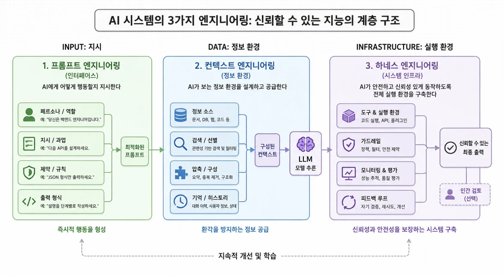
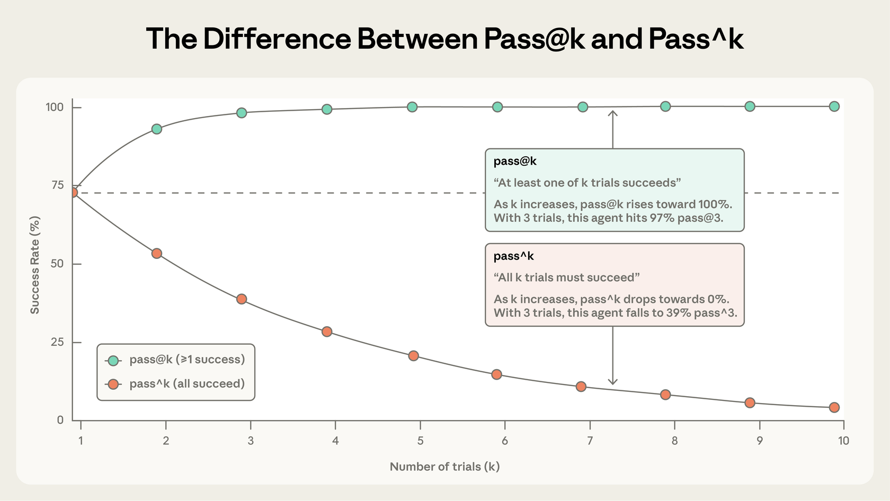

En este artículo quiero hablar sobre prompt engineering, context engineering y lo que podría venir después.

Mientras terminaba el artículo anterior sobre [cómo ahorrar tokens](/260611), hubo una pregunta que no dejaba de rondarme. Creo que el centro de gravedad está pasando del trabajo sobre prompts individuales a la técnica de vaciar y seleccionar información —context engineering—. Al cerrar aquel texto, la siguiente pregunta surgió de forma natural: entonces, ¿qué viene después del contexto?

Hay que ser prudente al hablar de «la dirección futura». El futuro admite innumerables caminos; por eso, aquí nos centramos en ordenar **el cambio de énfasis que puede leerse en fuentes primarias ya publicadas**. Aunque inevitablemente haya cierta inferencia, espero que el texto se lea desde perspectivas diversas.

## Del prompt al contexto

Empecemos por aclarar los términos. Durante un tiempo, el gran tema del sector fue el **prompt engineering**. La cuestión era cómo redactar bien una única instrucción para el model: cómo diseñar indicaciones claras, buenos ejemplos y el formato de salida.

Después creció la unidad de trabajo. Al hacerse habituales los agentes que operan durante decenas de turnos en lugar de responder a preguntas puntuales, dejó de importar solo un prompt y pasó a ser crucial cómo componer **todo el contexto que el modelo ve en cada turno** (system prompt + definiciones de herramientas + historial de conversación + resultados de búsqueda + memoria). A esto lo llamamos **context engineering**. Anthropic articuló este marco en septiembre de 2025 con «Effective context engineering for AI agents». El estudio sobre context rot publicado ese mismo año por el equipo de Chroma (Hong et al.) añadió evidencia cuantitativa. Experimentaron con 18 modelos, entre ellos GPT-4.1, Claude 4, Gemini 2.5 y Qwen3. Incluso en tareas tan sencillas como copiar palabras literalmente, el rendimiento se degradó de forma desigual a medida que crecía la entrada. La suposición habitual de que un modelo trata igual el token número 100 y el número 10,000 no se sostiene en la práctica. En lugar de la suposición habitual de que «cuanto más largo el contexto, mejor», su conclusión de que «cómo se coloca la información importa tanto como qué contiene» impulsó el paso de llenar a seleccionar y, como resultado, ayudó a que el término se asentara con rapidez.

Se suele pensar, por error, que el context engineering sustituyó al prompt engineering. Escribir buenos prompts sigue siendo fundamental; el context engineering **incluye el prompt engineering y amplía su alcance**. (Que el interés pase de escribir buen código a diseñar buenos sistemas no vuelve innecesario el coding.) El context engineering puede considerarse un concepto superior al prompt engineering.

Volvamos entonces a la pregunta: ¿esa ampliación terminó en el contexto? No parece que sea así.

## El blog de ingeniería de Anthropic

Creo que la forma más honesta de intuir una dirección es leer en orden cronológico qué publican quienes realmente están impulsando el campo. Sigamos el blog de ingeniería de Anthropic después de «Effective context engineering» (septiembre de 2025). Los títulos por sí solos ya dibujan hacia dónde siguió moviéndose el centro de gravedad.

- Octubre de 2025, Equipar agentes con Agent Skills
- Noviembre de 2025, Code execution with MCP: agentes más eficientes
- Noviembre de 2025, Effective harnesses for long-running agents
- Enero de 2026, Demystifying evals for AI agents
- Enero de 2026, Diseñar evaluaciones técnicas AI-resistant
- Febrero de 2026, Cuantificar el ruido de infraestructura en evaluaciones de agentic coding
- Marzo de 2026, Harness design for long-running application development
- Abril de 2026, Scaling Managed Agents: separar cerebro y manos
- Mayo de 2026, Cómo contener a Claude en todos los productos

Visto con algo de distancia, los términos se agrupan en tres ramas: **harness**, **eval** y **containment**. Lo interpreto como un debate que sube un nivel desde cómo llenar y vaciar el contexto hacia cómo diseñar, medir y controlar el sistema de agentes completo. (Naturalmente, existe la limitación de que son las prioridades de una empresa. Dado el peso que tiene en el ecosistema de coding agents, cuesta reducirlas a los intereses de un único vendor.)

Veamos cada rama.

## harness

La palabra harness puede resultar poco familiar. Literalmente es un arnés: el equipo que se coloca a un caballo para dirigir su fuerza. En un agente de IA, harness designa **todo el armazón que rodea al model desde fuera y lo pone a trabajar**: qué tools puede usar y en qué orden, cómo recuperarse de un fallo, hasta dónde llegan sus permisos y cuándo se detiene el loop.

Si context engineering pregunta «¿qué le mostramos al model?», el diseño de harness pregunta «¿cómo hacemos que el model se mueva dentro de ese entorno?». Está una capa más afuera. Si el model fuera una persona recién contratada y muy capaz, el contexto serían los materiales de trabajo que recibe, mientras que el harness sería el entorno y el manual de procedimientos. La misma persona puede rendir de forma irregular en un espacio caótico y llegar mucho más lejos, con idénticas capacidades, sobre un proceso bien diseñado.

La importancia se ve con claridad en [un fracaso al que se enfrentó directamente el equipo de ingeniería de Anthropic](https://www.anthropic.com/engineering/effective-harnesses-for-long-running-agents). Colocaron su mejor coding model, Opus 4.5, sobre Claude Agent SDK, le dieron solo instrucciones de alto nivel como «crea un clone de claude.ai» y lo ejecutaron durante varias sesiones. Pero, aunque el model era inteligente, no produjo una app de nivel production. Los fallos se repetían de dos maneras. En una, la sesión intentaba terminar todo de una vez, agotaba el contexto a mitad de la implementación y dejaba a la siguiente una función a medio construir. En la otra, una sesión posterior veía que «ya se ha avanzado bastante» y declaraba que había terminado pese al trabajo pendiente. (Es como una tarea larga repartida por turnos entre varias personas, donde cada relevo carece por completo de los recuerdos del anterior.)

La solución no fue hacer más inteligente al model, sino cambiar el armazón. La primera sesión recibió un prompt exclusivo para preparar el entorno (initializer agent), desplegó más de 200 especificaciones funcionales en `feature_list.json` y creó `init.sh` para iniciar el servidor de desarrollo, además de un log de progreso (`claude-progress.txt`). Cada sesión posterior (coding agent) se ocupaba exactamente de una función, dejaba un estado limpio mediante un git commit y notas de progreso, y terminaba. La siguiente leía primero ese progress file y el git log para saber «hasta dónde llegó el turno anterior» y continuar desde allí. Era el mismo model, pero el resultado cambió al colocarlo sobre este armazón. (Las recetas de Anthropic son exactamente lo que hace a diario una persona con experiencia en desarrollo. La lista de funciones, los commits pequeños, las notas de progreso y los smoke tests ejecutados siempre son ejemplos de ello. Un buen armazón para un agente consiste en incrustar buenos hábitos de engineering en el entorno.)

La conexión con el ahorro de tokens también es clara. El aislamiento de subagentes, la reducción de definiciones de tools y el model routing tratados en el artículo anterior parecen técnicas independientes si se observan por separado. Juntas, sin embargo, son partes de **cómo se diseña un único harness**. Decidir a qué model lane se envía cada tarea, qué tools permanecen activas y dónde se aísla la exploración verbose forma parte del diseño de harness. El ahorro es un efecto secundario que se deriva de ese diseño.

Sin embargo, el diseño de harness encierra una trampa: **cuanto mejor diseñado está el armazón, más probable es que envejezca cuando mejora el model.** Un harness es, en esencia, un conjunto de supuestos sobre «lo que el model no puede hacer por sí solo». En cuanto puede hacerlo, esos supuestos se convierten en carga. Un [caso de Anthropic](https://www.anthropic.com/engineering/managed-agents) lo ilustra. Sonnet 4.5 tendía a apresurarse para terminar cuando se acercaba al límite de contexto —context anxiety—, así que el armazón incorporó un mecanismo de context reset. Al usar el mismo armazón con Opus 4.5, aquel hábito había desaparecido y el reset cuidadosamente añadido ya no hacía falta. Cada vez que el model se hace un poco más capaz, alguna parte del armazón pierde su utilidad.

De ahí surge una idea adicional: en lugar de perfeccionar un armazón concreto, **diseñar interfaces que permanezcan estables aunque el armazón cambie**. Managed Agents de Anthropic sigue esta dirección, cuyas raíces están en los sistemas operativos. El OS ha resistido durante décadas porque virtualizó el hardware en abstracciones como procesos y archivos, creando por adelantado un recipiente para programas que aún no existían. Una línea de `read()` funciona igual con un disco de la década de 1970 que con un SSD actual. Aplicado a los agentes, el mismo razonamiento los divide en tres piezas: el **cerebro** que decide (Claude y el harness), las **manos** que actúan (sandbox de ejecución de código y tools) y el **session log** que registra mediante append todo lo ocurrido. Al separarlas, si muere el container, el cerebro puede tratarlo como un error de tool call; y si muere el harness, puede despertar desde el último punto del session log. Como efecto secundario también bajaron el coste y la latencia. Al iniciar containers solo cuando eran realmente necesarios, Anthropic afirma que el time to first token (TTFT) cayó cerca de un 60% en la mediana y, en p95, más de un 90%. (Aquí volvemos a encontrarnos con el artículo sobre tokens. Allí se recomendaba poner delante las partes estáticas para aprovechar prompt caching; decidir «cómo disponer el contexto para mejorar el cache hit rate» es precisamente la tarea del harness que acompaña a este cerebro.)

## eval

La segunda rama fue la que más me llamó la atención. Como si se hubieran puesto de acuerdo, los artículos de comienzos de 2026 convergen en la **evaluación (eval)**.

La razón resulta natural. **¿Con qué comprobamos** si el contexto está bien compuesto, el harness bien diseñado o el coste realmente reducido? Cuanto más largas y complejas son las tareas que un agente resuelve de forma autónoma, más difícil resulta revisarlas todas a simple vista. La base de la confianza se desplaza hacia la medición. Por eso los temas relacionados con la evaluación han pasado al primer plano: «¿cómo diseñar la evaluación de agentes?», «¿cómo eliminar el ruido de la propia evaluación?» o «¿cómo tratar el eval awareness, cuando el model detecta que lo evalúan y cambia su conducta?».

Evaluar agentes es difícil porque no se parece a una pregunta y respuesta de una sola vez. Un agente llama a tools y cambia estados a lo largo de varios turnos, de modo que un error se propaga y acumula. Además, los resultados varían entre ejecuciones aun con la misma entrada. [Anthropic](https://www.anthropic.com/engineering/demystifying-evals-for-ai-agents) divide esta no determinación en dos métricas. **pass@k** es la probabilidad de acertar al menos una vez en k intentos, por lo que crece al aumentar los intentos. **pass^k** es la probabilidad de acertar los k intentos, por lo que disminuye. En generación de código que solo necesita funcionar una vez importa pass@1; en un agente de atención al cliente que debe funcionar siempre, pass^k es fundamental. (Con una tasa de éxito per-trial del 75%, la probabilidad de tres éxitos seguidos es 0.75³, cerca del 42%. Así de grande es la distancia entre «suele funcionar» y «funciona siempre».)

Para puntuar un intento, el mismo artículo distingue tres tipos de grader. Los **code-based** (tests superados, static analysis y validación de tool calls) son rápidos, baratos y objetivos, pero débiles en tareas abiertas con varias respuestas válidas. Los **model-based** (LLM-as-judge y puntuación mediante rubric) captan una calidad más sutil, pero son no deterministas y deben calibrarse periódicamente con evaluación humana. Los **human-based** son los más exactos, pero lentos y caros. En la práctica se combinan los tres, preferiblemente con evaluación determinista como base y la del model como apoyo. Hay otra distinción. Un **capability eval** pregunta «¿qué puede lograr este agente?» y ofrece una cuesta que remontar partiendo de una puntuación baja. Un **regression eval** pregunta «¿sigue haciendo lo que antes hacía?» y debe mantenerse casi en el 100%. Si la puntuación cae, es señal de que algo se ha roto.

Aquí hay una trampa que se pasa por alto con frecuencia: **la causa de una puntuación baja puede estar en la evaluación.** Según el informe de Anthropic, Opus 4.5 obtuvo inicialmente un 42% en CORE-Bench. Al investigar encontraron evaluaciones rígidas que esperaban «96.124991…» y marcaban «96.12» como incorrecto, especificaciones ambiguas y tareas estocásticas imposibles de reproducir. Tras corregir bugs y repetir con un scaffold de restricciones más flexibles, la puntuación subió al 95%. Por eso insisten en un principio: **no aceptes la puntuación sin más; lee tú mismo el transcript (registro de ejecución).** Si un frontier model realiza 100 intentos y obtiene un 0%, la causa suele estar más en una especificación defectuosa de la propia tarea que en la capacidad del model.

La línea de base también se mueve deprisa a medida que avanza la medición. Existe SWE-bench Verified, un benchmark destacado de coding agents que presenta issues reales de GitHub y puntúa si pasan los tests. En él, los frontier models pasaron de la franja del 30% a más del 80% en 1 año. A esas alturas, todos los problemas fáciles están resueltos, la puntuación toca techo (saturation) y aparece una paradoja: grandes mejoras de capacidad solo se reflejan en pequeñas diferencias. Según se cuenta, una startup de code review desestimó al principio un model nuevo tras mirar solo evaluaciones one-shot; no vio bien la mejora hasta que adoptó evaluaciones de agentes con tareas más largas y complejas. Por eso las evaluaciones deben sustituirse continuamente por otras más difíciles. (Anthropic lo compara con el «Swiss cheese model» de la ingeniería de seguridad. Una loncha con agujeros no basta, pero al superponer evaluación automática, production monitoring y revisión humana de transcripts, el fallo que atraviesa una capa queda atrapado en la siguiente.)

## containment

La tercera rama tiene un carácter algo distinto. Trata del problema de **seguridad y control**.

Cuantas más herramientas maneja un agente y mayor es su autonomía, más crece el alcance de un solo error —su blast radius—. Para un agente capaz de borrar archivos, enviar solicitudes externas y ejecutar acciones privilegiadas en nombre de alguien, «¿dónde detenemos el daño cuando se equivoca?» importa tanto como «¿qué tan bien lo hace?». En este contexto puede leerse el protagonismo que Anthropic dio en mayo de 2026 a su artículo sobre [containment en todos sus productos](https://www.anthropic.com/engineering/how-we-contain-claude). Divide el riesgo de los agentes en tres ramas: **user misuse**, cuando un usuario solicita algo dañino con malicia o descuido; **model misbehavior**, cuando el modelo actúa por sí mismo sin que nadie se lo pida; y **external attacks** que llegan mediante herramientas, archivos o redes. También señala que hacer más inteligente al modelo no siempre reduce el riesgo. Los modelos menos capaces interpretan mal la situación y cometen errores obvios; los más capaces se equivocan menos, pero encuentran mejor rutas inesperadas para sortear restricciones que nadie escribió de forma explícita.

Consideran que «supervisar cada acción con una persona» tiene sus límites. Claude Code buscó inicialmente la seguridad pidiendo aprobación para cada escritura, ejecución y acceso a la red, pero la telemetría mostró que los usuarios aceptaban sin más cerca del 93% de las solicitudes. Cuantas más ventanas aparecen, menos atención recibe cada una: surge la **approval fatigue**. La defensa probabilística basada en clics humanos deja agujeros. El centro de gravedad pasa de «vigilar lo que hace el agente» a «limitar lo que puede hacer desde el principio». Las defensas se apilan en tres capas: la **capa de entorno**, con sandbox, VM y control de egress; la **capa del model**, con system prompts y classifiers; y la **capa de contenido externo**, con MCP, plugins y resultados de búsqueda. El principio esencial es **instalar primero la capa de entorno, que bloquea de manera determinista**. En el benchmark de Gray Swan, las defensas de la capa del model muestran un rendimiento de primera categoría, con una tasa de éxito de ataques únicos de alrededor del 0.1%. Aun así, con 100 intentos adaptativos sube al 5–6%, y una defensa probabilística no puede alcanzar por naturaleza un 100% de aciertos. Por eso se instala la frontera dura con la que el agente se encontrará al final. (Según se informa, al introducir un sandbox a nivel de OS, las solicitudes de aprobación se redujeron un 84%. La medida de seguridad redujo la fricción.)

Aunque parezca alejado del ahorro de tokens, comparte la misma raíz. Ambos preguntan **«¿qué le damos al agente y hasta dónde?»** Anthropic muestra bien la conexión con dos casos. En uno, el red team interno hizo phishing a un empleado para que ejecutara Claude Code con un prompt malicioso. Una instrucción oculta le hizo leer `~/.aws/credentials` y enviar el contenido fuera mediante POST; de 25 intentos, funcionó 24 veces. Como el usuario había escrito directamente la instrucción, el classifier del model no vio nada sospechoso. Lo impidieron la frontera ambiental que mantenía las credenciales fuera del sandbox y el control de egress. El segundo caso es más sutil. Una allowlist de egress permitió correctamente `api.anthropic.com`, pero un archivo plantado por un atacante usó su propia API key para llamar a la API de carga de archivos de Anthropic, y los datos salieron hacia la cuenta atacante. El sandbox funcionó perfectamente, pero aun así hubo fuga. La lección fue entender la allowlist como «permiso para todas las capacidades disponibles en ese dominio», en lugar de como un «filtro de destinos». (Anthropic repite este principio: los hypervisors, filtros de syscall y runtimes de containers ya verificados resistieron; **lo que se rompió fueron los componentes que ellos mismos habían construido encima**.) Retirar tools de MCP que no se usan pertenece al mismo contexto: ahorra coste y reduce la attack surface. Mantener un diseño ligero no solo lo hace más barato y preciso, sino también más seguro.

## En resumen

Las tres ramas se pueden condensar en una frase. La unidad de atención se expande un nivel cada vez: **del prompt (una instrucción), al contexto (qué mostrar en cada turno), y luego al sistema de agentes completo (cómo operarlo, medirlo y contenerlo)**. Harness responde a «¿cómo hacerlo funcionar?», eval a «¿cómo sabemos si funcionó bien?» y containment a «¿cómo lo detenemos si funciona mal?».

Estas tres ramas son **un cambio de énfasis que el autor infiere de materiales ya publicados**. No es una predicción del tipo «esto será el estándar en la segunda mitad de 2026». Algunas corrientes crecerán y otras se integrarán bajo nombres diferentes. Tanto el prompt como el contexto seguirán existiendo como partes de un marco mayor. El campo ha avanzado añadiendo una capa sobre las anteriores, sin que las palabras nuevas borren las viejas, y es probable que siga haciéndolo.

Empezamos hablando de costes y llegamos hasta aquí. El artículo anterior recomendaba abrir el libro de cuentas de tokens; este propone dar un paso más. Conviene examinar a la vez **cómo verificamos** el ahorro (eval), **sobre qué armazón puede repetirse** (harness) y **hasta dónde es seguro ese armazón** (containment). Al final, lo que más perdure probablemente no será una técnica de ahorro concreta, sino el hábito de medir y controlar el propio sistema.

:::ref
- [article] [Anthropic, Effective context engineering for AI agents](https://www.anthropic.com/engineering/effective-context-engineering-for-ai-agents)
- [article] [Anthropic, Harness design for long-running application development](https://www.anthropic.com/engineering/harness-design-long-running-apps)
- [article] [Chroma Research, Context Rot](https://research.trychroma.com/context-rot)
:::